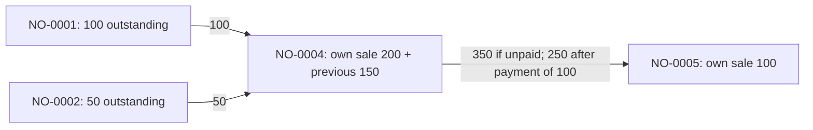

# Implementation Plan: Order Previous Balance Management

**Status: proposed, awaiting approval. No feature implementation or database changes have been performed.**

Prepared on 28 October 2026 (Asia/Phnom_Penh). Reviewed repository revision `62c8c68` and the current working tree, including the configured database through read-only transactions. This document is the only project file created for this request. Existing unrelated working-tree changes are outside this plan.

## 1. Recommended approach

Keep `orders.total_price` as the order's **own sale value**. Add a saved `orders.previous_balance`, and record each movement of outstanding debt in a dedicated `order_balance_transfers` table. Calculate the amount collectible from the current order using its own sale, incoming balance, actual payments, and completed outgoing transfer.

A source order becomes `Paid` as requested, but its cash receipts and original totals do not change. Its transfer relationship explains the settlement and reduces its active outstanding balance to zero. Never call the existing “mark paid” endpoint to perform a transfer: that endpoint creates an actual `OrderPayment`.

Use the same balance calculation and transaction rules in all reachable order payment paths. Changing only Create Order and the invoice would leave incorrect reports and routes capable of reopening transferred debts.

The design preserves product pricing, discounts, commissions, stock movements, customer points, invoice numbering, layouts, navigation, existing permission names, and ordinary orders without transferred balances. Necessary behavior changes and approval decisions are identified below.

## 2. Evidence and current implementation

### 2.1 Inspection boundary

Inspected the actual models, controllers, requests, routes, services, relevant Blade/Alpine code, migrations, permission mapping, and existing tests. Read the root [AGENTS.md](AGENTS.md), [report rules](.agents/rules/report-standards.md), and [date picker rules](.agents/rules/datepicker-standards.md). Reviewed the core Select2 stylesheet and the current Create Order implementation.

Database inspection used direct PDO `START TRANSACTION READ ONLY`, SELECT statements, and rollback, without bootstrapping application requests or invoking migrations. Credentials and customer contact information are not reproduced here. The findings concern the configured local database; production schema and data have not been inspected.

No application tests or browser workflows were executed for this planning task. Existing tests were read, not modified. Proposed tests below have not passed or failed yet.

### 2.2 Current workflow map

| Area | Actual implementation | Consequence for this feature |
|---|---|---|
| Create and edit | [OrderController](app/Http/Controllers/Admin/OrderController.php): `onCreate()`, `edit()`, `Save()`, `formData()`. Both create and edit render `createOrder.blade.php`. | Do not implement the feature only in the separately named `editOrder.blade.php`; it is not the current controller's edit view. |
| Save | `Save()` opens a transaction, validates existing order ownership and Pending status, reverses existing item effects on edit, replaces details, generates an invoice on create, applies stock, calculates totals, adjusts points, and records an initial payment. | Integrate consolidation into this transaction. Edit currently reads the order without `lockForUpdate()`; locking must precede financial validation and side effects. |
| Current sale calculation | [OrderPricing](app/Services/OrderPricing.php): `line()`, `totals()`, `usdCents()`, `usdString()`. Automatic product pricing uses saved original/unit prices. Legacy discounts and commissions remain supported. | Preserve these functions' sale calculations. Previous Balance is added after the existing current-sale calculation, not to any product line. |
| Existing commission behavior | `OrderPricing::totals()` returns rounded line totals **minus total commission**. Frontend `calculatorProductPrice()` likewise sets `amountPaid = total - commissionTotal`. | Despite its name, frontend `amountPaid` means current payable total, not cash collected. Do not confuse it with `paidAmount` or silently remove the commission deduction. |
| Order model | [Order](app/Models/Order.php) appends `remaining_amount = max(0, total_price - paid_amount)` using doubles; `forUser()`/`isOwnedBy()` enforce creator ownership for restricted users. | Add a transfer-aware calculation while retaining existing sale fields. Paid status alone cannot be the balance formula. |
| Main payments | `OrderController::addPayment()`, `updatePayment()`, `deletePayment()`, `updatePaymentStatus()`, `recordInitialPayment()`, `remainingPaymentCents()`, `syncOrderPaymentState()`, `paymentResponse()`. | Main add-payment checks use cents and a locked order. Update/delete currently lock payment before order. All limits and status synchronization currently use only `total_price`. |
| Other payment entry points | [RemainingAmountController](app/Http/Controllers/Admin/RemainingAmountController.php) duplicates payment creation/edit/deletion, response, and synchronization. | Must share the financial behavior. Its add-payment eligibility/amount checks currently happen before the lock and are not repeated after locking. It also lacks the main controller's record-ownership checks. |
| Mobile/legacy API | [routes/api.php](routes/api.php) still routes `store-booking`, `payment`, `detail`, and `earning` to [Api/BookingController](app/Http/Controllers/Api/BookingController.php). | `/payment` calculates `total_price - paid_amount`, creates payments, sets Paid, and debits a barber wallet using a request amount. It must not remain an unguarded alternate writer. Several API operations refer to `orders.barber_id`, which is absent in the inspected database. Runtime use is unverified. |
| Invoice | [InvoiceService](app/Services/InvoiceService.php): `previousBalance()` and `previousBalanceForMany()` sum other current Pending/Partial orders for the customer. There is no saved previous-balance field. | An older invoice can currently include debt from a newer invoice. Reprinting can change the displayed previous balance. Replace both methods' live-debt calculation with the saved snapshot. |
| Print templates | `order/invoice-template.blade.php` and `invoice-template-02.blade.php` add `invoicePreviousBalance` to `total_price` and again to `remaining_amount`. | Once remaining amount already includes saved previous balance, adding it again would double-count. Both templates require a small calculation change, preserving their print layouts. |
| Bulk printing | [OrderBulkPrintService](app/Services/OrderBulkPrintService.php): `prepareForPreview()` calls batch previous-balance calculation for invoices; delivery slips currently receive zero from this branch. | Pass the saved balance consistently to both document types that display monetary summaries. Preserve selection, row limits, pagination, language, and consolidated-product printing. |
| Customer Remaining report | [CustomerRemainingAmountReportService](app/Services/CustomerRemainingAmountReportService.php): `outstandingOrders()`, `customers()`, `history()`. The query includes non-Cancel orders with `total_price > paid_amount`, even if status is Paid. | Simply changing sources to Paid will NOT remove them from this report. SQL predicates, aggregate sums, and invoice history must change together. |
| History selection | [CustomerRemainingAmountReportController](app/Http/Controllers/Admin/Report/CustomerRemainingAmountReportController.php): `show()` selects **currently outstanding invoices first**, then builds their date-filtered histories and paginates whole invoices. | Preserve this report's current-outstanding scope; it is not a complete historical customer ledger. Explicitly distinguish transfer events from receipts. |
| Sales and transactions | [SalesReportController](app/Http/Controllers/Admin/Report/SalesReportController.php) and [OrderTransactionReportController](app/Http/Controllers/Admin/Report/OrderTransactionReportController.php) sum `total_price` for sales and `paid_amount` for receipts. Summaries and daily/monthly groups calculate remaining as `max(0, sales - paid)`. | Preserve sales and cash measures. Replace only the affected remaining calculations with summed active order balances; filtered groups otherwise lose transferred balances. |
| Dashboard | [DashboardController](app/Http/Controllers/Admin/DashboardController.php): `index()` directly sums `total_price - paid_amount` for Pending/Partial orders. | Update its outstanding total/count expressions; leave sales and unrelated dashboard calculations unchanged. |
| Other customer receipts | [CustomerPaid](app/Models/CustomerPaid.php)/`CustomerPaidController` use a separate `customer_paid` table, including USD/KHR fields. | These are not order payments. Do not write transfers to this table, `other_income_payments`, wallets, or any income ledger. |
| Permissions | [AdminPermissions](app/Support/AdminPermissions.php), [CheckAdminPermission](app/Http/Middleware/CheckAdminPermission.php), Order and Customer ownership scopes. | Explicitly map the new preview route and authorize every source. Existing generic route mapping rejects unmapped actions. |

### 2.3 Actual local schema and data

The inspected database reports MySQL **8.1.0**. Orders, details, payments, customers, inventory tables used by Save, customer points, and invoice sequences use InnoDB.

| Table | Relevant observed columns |
|---|---|
| `orders` | `id BIGINT UNSIGNED`; nullable `customer_id INT`, `shop_id INT`; `total_price`, `paid_amount`, `total_discount`, `total_commission` are DOUBLE; `payment_status VARCHAR(255)` default Pending; `payment_date DATETIME`; unique `invoice_number`; nullable `created_by BIGINT UNSIGNED`; order/delivery dates, timestamps, soft deletes. No `previous_balance`, transfer field, or separate cancellation status column. Cancellation is `payment_status = 'Cancel'`. |
| `order_payments` | `id BIGINT UNSIGNED`, `order_id INT`, `amount DOUBLE`, payment method/date, note, nullable `created_by INT`, timestamps, soft deletes. No request idempotency key or refund/reversal relationship. |
| `order_details` | `id BIGINT UNSIGNED`, `order_id INT`, legacy DOUBLE pricing/discount fields; `original_price` and `unit_price DECIMAL(15,2)`; `pricing_method VARCHAR(32)`. |
| `customers`, `users`, `shops` | Primary IDs are BIGINT UNSIGNED. Customer ownership is stored in `customers.user` as a string; order ownership is separate. |

New foreign keys must match **parent primary keys**, not copy legacy signed INT relationship columns. Existing order indexes include customer, status, date, shop, creator, and invoice uniqueness; many retain their original `bookings_*` names after the rename migration.

Read-only snapshot, 28 October 2026:

| Status | Orders | Own sale total | Recorded paid total |
|---|---:|---:|---:|
| Pending | 28 | $4,764.23 | $0.00 |
| Partial | 11 | $10,569.65 | $5,436.75 |
| Paid | 13 | $5,008.00 | $5,008.00 |
| Cancel | 6 | $12,683.80 | $0.00 |

All 58 orders were non-deleted. Across the 52 non-Cancel orders, sale total was **$20,341.88**, recorded paid total **$10,444.75**, and outstanding **$9,897.13**. One Pending/Partial order had no positive outstanding amount. There were no observed negative totals, negative paid amounts, overpayments, or Paid orders with positive debt. The reconciliation query returned no active order whose rounded `paid_amount` differed from the sum of its active payment records. Thirty-six orders had no creator; do not automatically assign them to the current operator.

These observations are a baseline, not permanent assumptions or permission to modify these records.

## 3. Financial contract and business decisions

### 3.1 Monetary definitions

All calculations below use integer USD cents, converting each existing stored monetary operand using the established `round(value * 100)` behavior. Reuse `OrderPricing` for line pricing and its decimal parsing where applicable. Do not round every historical field differently, switch currencies, or migrate existing DOUBLE columns as part of this feature.

```text
C = current order total from the existing OrderPricing::totals() result
P = saved orders.previous_balance
A = real paid_amount attached to this order, excluding transfers
T = sum of this order's completed outgoing transferred amounts (at most one row)

Total Amount Due D        = C + P
Unsettled document amount = max(0, D - A - T)
Active Outstanding       = Unsettled document amount for a live, non-Cancel order;
                           zero for cancelled or deleted orders
```

For an active destination that has not itself transferred, `T = 0`, so the requested `Balance Due = Current Order Total + Previous Balance - Payments Received` applies exactly. For a settled source, subtract the **noncash transfer settlement** as well; displaying `D - A` alone would show a debt already assigned to its successor.

Preserve the existing numerical meaning of `remaining_amount` for ordinary untransferred documents, including historical document displays. Extend it with `P - T`. Use an explicit `active_outstanding_amount`/equivalent service result for collectible totals, cancellation views, payment limits, and reminders, which always excludes Cancel/deleted records. A cancelled consolidated document can retain its original `C`, `P`, and `D` for audit, but its payable Balance Due is zero. Clearly label historical document values rather than treating them as active debt.

Do not persist a second `total_amount_due` or `balance_due` column. These would duplicate derived values and create more synchronization paths. Expose `current_order_total`, `previous_balance`, `total_amount_due`, `paid_amount`, `transferred_out_amount`, `remaining_amount`, `active_outstanding_amount`, and settlement metadata in a shared balance projection. Keep existing API keys and add explicit new ones; do not silently change the meaning of `total_price`.

**Existing formula difference:** the requested general formula includes “Applicable Charges”; this code has no general charges field and currently deducts commissions. Preserve that current calculation as `C`. Adding taxes/fees or removing the commission deduction requires a separate approved pricing change. Previous Balance is never discounted and never earns commission, stock movement, or points.

Guard against integer overflow and the `DECIMAL(15,2)` limit (`9,999,999,999,999.99`, consistent with `OrderPricing::MAX_CENTS`) before adding source balances or recording a payment. Reject sub-cent new payment input rather than silently rounding it into another payment amount.

### 3.2 Eligibility

An eligible source must satisfy all of these conditions at commit time:

1. Same selected customer as the new order; customer exists, is active, and can be used by the operator.
2. Existing live order with `payment_status IN ('Pending', 'Partial')`.
3. Positive active outstanding amount in cents.
4. No completed outgoing transfer. A source with a reversed transfer can become eligible again.
5. Existing access rules authorize viewing and financially updating that source.
6. It is not the new order itself. The destination must be a newly created order, not an arbitrary existing ID supplied by a client.

The eligibility query is **not date-filtered by the listing or by the entered order date**. “Previous” means already committed when creating the new order. Backdating a document does not backdate the transfer: `transferred_at` is the actual database operation time. No recursively expanded ancestors enter the eligibility sum.

Paid, Cancel, soft-deleted, fully transferred, zero/negative balance, and another customer's orders are excluded. An inconsistent Paid-with-debt record is a reconciliation issue, not an excuse to bypass the required status filter.

### 3.3 Recommended policy choices for approval

| Decision | Proposed behavior | Reason and compatibility impact |
|---|---|---|
| Customer scope | Consolidate the customer's eligible orders across shops, as requested. | Debt collection moves to the new order's shop; source sales stay in their original shops. This is material for shop-filtered outstanding reports. |
| Source authorization | Require existing create permission for the destination and existing order-update permission plus ownership/full-data access for every source. If any eligible source is inaccessible, reject consolidation with a generic authorization message; do not disclose hidden invoice details or silently consolidate only a subset. | Avoids expanding record access or silently claiming all customer debt was included. A create-only user can still create an ordinary order when there is no eligible debt. |
| Snapshot change during save | Return 409 with an authorized refreshed preview and keep the draft when source state has changed; let the user review the changed total before resubmitting. | A concurrent payment or new order must not silently change the amount the operator accepted. |
| Historical invoice previous balance | Existing rows receive default `P = 0`; all invoices use saved `P`, with no live-query fallback. | Existing debts remain on their own orders until explicitly transferred by a new order. Historical printed Previous Balance will intentionally differ from today's dynamic reprint behavior. Old printed snapshots cannot be reconstructed reliably. |
| Edit | Existing Pending-only editing stays. Incoming balance is immutable; freeze customer/shop on transfer-linked orders; block editing a source with a completed outgoing transfer. | Prevents moving received debt to another customer/shop or changing debt already transferred. Ordinary Pending orders retain normal editing. |
| Cancellation | Allow only an unpaid leaf destination, atomically reversing its immediate incoming transfers and then cancelling its own sale. Reject cancellation of a source with an outgoing transfer or a destination with payments. | Preserves debt by returning it to direct sources; existing unpaid-Pending cancellation rule remains the starting rule. |
| Deletion/restoration | Block soft deletion, hard deletion, and ordinary restore for any transfer-linked order, including reversed history. Use audited cancellation instead. | Existing delete/restore behavior remains for unrelated orders. Transfer history and source references cannot disappear. |
| Payment correction | Permit existing payment edit/delete on an active leaf under locks; forbid monetary changes on transferred sources until the dependent transfer chain is safely unwound. | Prevents reopening debt twice. No silent propagation through paid descendants. |
| Refunds | Do not invent negative payments or a cash-refund workflow. Reject unsupported refunds and source changes that need refund allocation; describe the blocking condition and dependent invoice. | There is no complete refund ledger in the inspected Order module. A true cash disbursement/refund feature requires an explicitly approved design, not repurposed balance transfers. |

These are recommendations in this approval document, not policies already implemented. If cross-shop collection, linked-order cancellation restrictions, or refund requirements differ, adjust this plan before implementation.

## 4. Proposed data structure

### 4.1 Required financial storage

Add `orders.previous_balance DECIMAL(15,2) NOT NULL DEFAULT 0.00`, cast as a decimal string, set only by the server during new-order consolidation. Do not mass-assign it from request data. Existing `total_price`, `paid_amount`, `payment_date`, details, and receipts retain their meanings.

Add `order_balance_transfers`, one row per **direct source → destination**:

| Field | Purpose |
|---|---|
| `id` | Transfer identity. |
| `new_order_id` | Destination, foreign key to `orders.id`. |
| `previous_order_id` | Direct source, foreign key to `orders.id`. |
| `transferred_amount` | Exact outstanding cents converted to DECIMAL at transfer time. Immutable. |
| `original_payment_status` | Pending or Partial immediately before transfer. Immutable. |
| `transferred_at`, `transferred_by` | Server time and authenticated admin ID. Immutable. |
| `transfer_status` | `completed` or `reversed`. No committed draft/failed transfers. |
| `reversed_at`, `reversed_by`, `reversal_reason` | Required audit information when safely reversing a transfer. |
| `active_source_order_id` | Generated value equal to source ID only when completed; unique index guarantees at most one active outgoing transfer per source. |
| `created_at`, `updated_at` | Normal timestamps; original fields remain immutable. |

Foreign keys use InnoDB's restrictive default for order deletion. Do not cascade-delete audit records or soft-delete transfer rows. Retain actors via soft-deleted user relationships; reject hard deletion of referenced actors rather than losing transfer attribution.

Relationships on Order:

```text
incomingBalanceTransfers(): hasMany(OrderBalanceTransfer, new_order_id)
outgoingBalanceTransfers(): hasMany(OrderBalanceTransfer, previous_order_id)
completedOutgoingBalanceTransfer(): one currently completed outgoing row
```

Expose completed and historical transfers separately. Eager-load direct sources/destinations and transfer totals in listing/report/print paths; do not create an N+1 database query in `remaining_amount` serialization. Accessors must distinguish “aggregate not loaded” from “loaded and zero”; the query/service layer must provide the projection consistently.

**Why a relationship table:** JSON/CSV reference IDs cannot reliably store individual amounts, enforce one active transfer per source, support safe reversal, or trace multiple generations. A single `transferred_to_order_id` field cannot retain re-transfer history after reversal without overwriting evidence.

### 4.2 Minimal retry protection

Transactions and row locks prevent simultaneous overpayment but do not prevent repeating a valid partial payment after a response is lost. Add:

- `orders.creation_request_key` and `creation_payload_hash`, nullable for old records; unique request key for new order submissions.
- `order_payments.payment_request_key` and `payment_payload_hash`, nullable for old records; unique request key for every new receipt, including initial deposit and “pay remaining.”

Generate a stable UUID for a logical UI action and retain it during retries, including a persisted Create draft. Store a hash of normalized input, action/order/customer identifiers, actor, and submitted preview fingerprint. This hashes the client's accepted request, not mutable server totals after the action. A retry with the same key and payload returns the existing authorized result; the same key with different input returns 409. Query with trashed records when recognizing retries, so a deleted payment is never silently recreated.

An initial payment's key is deterministically associated with the create request so the same create cannot produce a second receipt. New intentional installments use new keys, even if their amounts match. Time/amount/customer heuristics must not suppress legitimate payments.

Payment edits use an expected-state fingerprint checked after locks to reject stale overwrites. Repeated deletes return an already-deleted result after authorization, with no second effect. No generic queue, event bus, or unrelated audit subsystem is required.

### 4.3 Draft SQL for manual review only

**Do not execute this section during planning.** These are proposed schema changes, not a ready deployment instruction. Verify the production MySQL/MariaDB version, constraint support, parent key types, indexes, table prefix, maintenance impact, and backup before approving migrations. The syntax below targets the inspected MySQL 8.1 structure.

```sql
ALTER TABLE orders
    ADD COLUMN previous_balance DECIMAL(15,2) NOT NULL DEFAULT 0.00,
    ADD COLUMN creation_request_key CHAR(36) NULL,
    ADD COLUMN creation_payload_hash CHAR(64) NULL,
    ADD UNIQUE KEY orders_creation_request_unique (creation_request_key),
    ADD KEY orders_balance_candidates_idx
        (customer_id, deleted_at, payment_status, id),
    ADD CONSTRAINT orders_previous_balance_nonnegative
        CHECK (previous_balance >= 0);

ALTER TABLE order_payments
    ADD COLUMN payment_request_key CHAR(36) NULL,
    ADD COLUMN payment_payload_hash CHAR(64) NULL,
    ADD UNIQUE KEY order_payments_request_unique (payment_request_key);

CREATE TABLE order_balance_transfers (
    id BIGINT UNSIGNED NOT NULL AUTO_INCREMENT,
    new_order_id BIGINT UNSIGNED NOT NULL,
    previous_order_id BIGINT UNSIGNED NOT NULL,
    transferred_amount DECIMAL(15,2) NOT NULL,
    original_payment_status VARCHAR(16) NOT NULL,
    transferred_at DATETIME(6) NOT NULL,
    transferred_by BIGINT UNSIGNED NOT NULL,
    transfer_status VARCHAR(16) NOT NULL DEFAULT 'completed',
    reversed_at DATETIME(6) NULL,
    reversed_by BIGINT UNSIGNED NULL,
    reversal_reason VARCHAR(500) NULL,
    active_source_order_id BIGINT UNSIGNED
        GENERATED ALWAYS AS (
            CASE WHEN transfer_status = 'completed'
                 THEN previous_order_id ELSE NULL END
        ) STORED,
    created_at TIMESTAMP NULL,
    updated_at TIMESTAMP NULL,
    PRIMARY KEY (id),
    UNIQUE KEY obt_one_active_source (active_source_order_id),
    UNIQUE KEY obt_source_destination (previous_order_id, new_order_id),
    KEY obt_destination_status (new_order_id, transfer_status),
    KEY obt_source_history (previous_order_id, transferred_at),
    CONSTRAINT obt_destination_fk FOREIGN KEY (new_order_id)
        REFERENCES orders(id),
    CONSTRAINT obt_source_fk FOREIGN KEY (previous_order_id)
        REFERENCES orders(id),
    CONSTRAINT obt_actor_fk FOREIGN KEY (transferred_by)
        REFERENCES users(id),
    CONSTRAINT obt_reversal_actor_fk FOREIGN KEY (reversed_by)
        REFERENCES users(id),
    CONSTRAINT obt_positive_amount CHECK (transferred_amount > 0),
    CONSTRAINT obt_forward_order CHECK (previous_order_id < new_order_id),
    CONSTRAINT obt_valid_original_status
        CHECK (original_payment_status IN ('Pending', 'Partial')),
    CONSTRAINT obt_valid_status CHECK (transfer_status IN ('completed', 'reversed')),
    CONSTRAINT obt_valid_reversal CHECK (
        (transfer_status = 'completed' AND reversed_at IS NULL
            AND reversed_by IS NULL AND reversal_reason IS NULL)
        OR
        (transfer_status = 'reversed' AND reversed_at IS NOT NULL
            AND reversed_by IS NOT NULL AND reversal_reason IS NOT NULL
            AND CHAR_LENGTH(TRIM(reversal_reason)) > 0)
    )
) ENGINE=InnoDB DEFAULT CHARSET=utf8mb4 COLLATE=utf8mb4_unicode_ci;
```

The forward-ID constraint follows the rule that only a newly inserted destination can receive transfers; it prevents self-links and cycles. It is not a restriction on backdated `order_date`. If production uses a different ID-allocation strategy, replace this constraint with an equivalent verified acyclic rule before deployment.

The unique generated active-source index permits historical reversed rows and one later completed transfer. `UNIQUE(previous_order_id, transfer_status)` is **not** sufficient: it would incorrectly forbid a second historical reversal. MySQL permits multiple NULLs in a nullable unique index, which supports this design. See the official [MySQL unique-index documentation](https://dev.mysql.com/doc/refman/8.0/en/create-index.html). Application validation remains necessary for same-customer relationships, immutable amounts, permissions, and exact source balance.

The draft omits explicit foreign-key action clauses and relies on InnoDB's restrictive default; it does not use cascade/set-null actions on fields participating in checks or generated expressions. Validate the complete DDL on an isolated instance of the deployment version before manual execution, including the interaction between [foreign-key defaults](https://dev.mysql.com/doc/refman/8.0/en/constraint-foreign-key.html), [CHECK restrictions](https://dev.mysql.com/doc/refman/8.0/en/create-table-check-constraints.html), and [generated-column restrictions](https://dev.mysql.com/doc/refman/8.0/en/create-table-generated-columns.html). Reading documentation is not a substitute for that schema test; no DDL was run during planning.

Only the Markdown contains this SQL. Do not create migration files, execute DDL, infer historic transfers, or insert balancing receipts before approval. No historical monetary data backfill is needed; defaults supply zero for legacy orders.

## 5. Shared balance and transfer behavior

Introduce narrow services, with final names confirmed during implementation:

- `OrderBalanceService`: cent conversion/bounds, due/settlement projection, consistent SQL balance expressions and active-order scope, payment status calculation. Reuse existing pricing rather than replacing it.
- `OrderBalanceTransferService`: preview/eligibility, fingerprint validation, transfer insertion, source settlement, guarded reversal. It participates in the caller's transaction and never independently commits.
- `OrderPaymentService`: shared financial mutation core extracted from the two payment controllers, retaining their route names, permissions, validation messages, and response compatibility. It uses the same customer/order locks and balance service.
- `OrderBalanceTransfer` model: relationships and immutable original transfer metadata.

Keep stock and point functions in their current module. Do not introduce transfer lines into `order_details`, call `reverseOrderEffects()` on a transferred source, or duplicate source receipts on a destination.

For a completed outgoing source, status synchronization must preserve `Paid` with settlement kind `balance_transfer`, even though `paid_amount < total_amount_due`. A defensive mismatch between recorded outgoing amount and expected debt is a conflict for reconciliation, not a reason to silently reopen it.

For a live leaf with a positive amount due:

| Actual paid cents | Payment status |
|---|---|
| 0 | Pending |
| Greater than 0 and less than D | Partial |
| Exactly D | Paid |
| Greater than D | Reject the attempted mutation; flag existing inconsistent records separately. |

Zero-value legacy orders must retain their existing workflow and remain non-payable. Do not run a bulk status normalization; the current create flow can retain Pending when no initial payment was recorded. Define and regression-test the zero-due branch explicitly instead of accidentally changing it through a new unconditional sync call. A zero current sale with positive previous balance has positive D and follows the table above.

`payment_date` remains the existing real-payment completion field. Do not populate it with transfer time; use `transferred_at` for that. Existing payment dates, methods, notes, actors, and receipt IDs remain attached to their original orders.

## 6. Order creation and atomic consolidation

### 6.1 Read-only preview

Add a named GET route such as `admin-order-previous-balance`, mapped explicitly in `AdminPermissions`. It validates selected customer access, source access, and returns:

```text
customer_id
previous_balance (decimal string) and previous_balance_cents
sources: [{ order_id, invoice_number, original_payment_status,
            total_amount_due, paid_amount, outstanding_amount }]
preview_fingerprint
```

Build the fingerprint from customer ID, the complete ordered source set, source financial/state values, relevant payment state, and outgoing-transfer state. Prefer a server-signed digest; a digest is concurrency detection, not permission to trust client amounts. No preview call changes orders, reserves balances, or allocates invoice numbers. Failure is displayed as an error, not as a misleading $0.00 balance.

### 6.2 Transaction sequence

1. Apply existing `OrderRequest` cart/customer/shop/date validation and module permission checks. Ignore/reject client `previous_balance`, settlement flags, and proposed transfer amounts as financial authority.
2. Start the outer transaction. Use a bounded deadlock retry around the **whole transaction**, not around individual transfer inserts. No success messages or external notifications inside a retryable closure.
3. Lock the selected customer row first. For an edit changing customers, lock old and new customer IDs in ascending order, re-read the order, and retry/reject if its customer changed during acquisition. This parent-row lock also serializes the case where the customer currently has zero orders.
4. Check the create request key with trashed records included. An authorized matching completed request returns the existing result without new stock, invoice, order, payment, or transfer work; a mismatched hash returns 409.
5. Select and lock candidate existing orders in ascending ID order. Revalidate customer, eligibility, authorization, current balances, and completed outgoing transfers under those locks. Do not trust pre-transaction checks or a repeatable-read snapshot created before the customer lock.
6. Recompute the fingerprint. If it differs from the submitted accepted preview, roll back and return a refresh response. A source paid/cancelled/edited since preview is never transferred using its stale amount.
7. Sum each direct source's remaining cents exactly once. Record its original status in memory. Do not expand its incoming ancestry into this sum.
8. Continue the existing create flow: server payload, invoice generation, order row and details, stock validation/movements, `OrderPricing::totals()`, and point updates. Set `previous_balance` to the locked sum; retain calculated own `total_price`.
9. Insert one completed transfer per eligible source, with actual server time and authenticated actor. Unique active-source and source/destination constraints are a second defense against duplicates.
10. Set each source `payment_status = 'Paid'`. Preserve its `total_price`, `previous_balance`, `paid_amount`, existing `payment_date`, details, stock, points, and receipt rows. Its outgoing transfer now makes its remaining amount zero.
11. Validate and record only the new order's actual initial payment against **D**, using its stable payment key. A deposit can exceed the new goods value C when it is paying transferred debt, but cannot exceed D.
12. Calculate destination status and verify transaction invariants. A no-payment destination with positive D is Pending. Check saved P equals its incoming transfer sum and every source has zero outstanding.
13. Commit once. Afterwards return the existing success fields plus the new financial projection and affected source IDs for local workspace refresh. Set flash/session state only after commit.

Any validation error, unavailable stock, failed detail creation, invoice failure, payment failure, unique conflict, or exception rolls back **all** order/details/payments/transfers/source-status/stock/points changes. Auto-increment gaps after failed transactions are acceptable; do not renumber existing invoices to fill gaps.

### 6.3 Lock order and competing writers

All financial writers must use the same order: customer IDs ascending → existing order IDs ascending → relevant transfer rows → payment IDs ascending → invoice sequence where needed → inventory rows in a deterministic shop/product order. New auto-increment destination IDs follow existing source IDs. Recheck ownership and financial conditions after acquiring locks.

Payment routes must acquire the customer lock **before** the order lock. Payment edit/delete must stop taking the payment lock first. Save/edit/cancel/delete/restore/destroy and any reachable API writer need the same parent coordination. Read a payment/order ID only to find its customer initially, then verify that relationship again under the final locks.

| Race | Required outcome |
|---|---|
| Two distinct creates from the same preview | First commits. Second sees changed source set and returns 409. On reviewed retry, it may transfer the first new order's remaining amount as a direct source. |
| Two retries of one create | Exactly one order, one set of stock effects, one transfer per source, and at most one initial payment. Both may receive the same success result. |
| Payment commits before consolidation | Locked preview changes; refresh before saving. Only the reduced outstanding can later transfer. |
| Consolidation commits before payment | Old-source payment is rejected as transferred, with an authorized link to the successor. It is not silently reassigned to another invoice. |
| Two partial payments | Serialize against refreshed due. Same key yields one receipt; distinct valid payments succeed only within the remaining due. |
| Edit/cancel/delete while consolidating | Serialize and revalidate. A completed outgoing transfer makes the source mutation invalid. |

Use a clear retryable conflict response for lock timeout/deadlock exhaustion. Do not hold database transactions across browser interaction, HTTP preview requests, or user confirmation.

Preserve meaningful HTTP errors through controller exception handling: 403 for authorization, 404 for unavailable records, 422 for invalid financial input or forbidden lifecycle transitions, and 409 for stale state/request-key conflicts. A failure to load the preview is not a zero-balance success. Unexpected failures return a translated message and correlation ID while logging details server-side; do not expose SQL, credentials, or raw exception messages. The transaction must roll back before any error response, including early returns in legacy API paths.

## 7. Multiple-generation transfers and worked scenarios



The graph records direct relationships, not copies of every ancestor. NO-0005 receives one row from NO-0004 in the above example. The NO-0001/NO-0002 rows remain attached to NO-0004. Trace ancestors lazily with a visited-ID set/depth guard for corrupted data; traversal is for audit only, never for eligibility summation.

### 7.1 Required examples

These are **synthetic scenarios**, separate from existing local records with the same invoice numbers.

| Scenario | Direct source outstanding | C | P | D | New-order payment | New-order balance/status |
|---|---|---:|---:|---:|---:|---|
| 1: NO-0004 | NO-0001 $100 + NO-0002 $50; NO-0003 Paid excluded | $200 | $150 | $350 | $0 | $350 Pending |
| 2: NO-0005 | NO-0004 $350, including its own prior balance | $100 | $350 | $450 | $0 | $450 Pending |
| 3: NO-0005 | NO-0004 $350 due less its $100 payment | $100 | $250 | $350 | $0 | $350 Pending |
| 4: NO-0008 | NO-0004 $350 + NO-0006 $75 + NO-0007 $125 | $200 | $550 | $750 | $0 | $750 Pending |

After each transfer, the direct sources have `Paid` plus “Paid through Balance Transfer,” unchanged original sale/receipt values, and zero active outstanding. Previously transferred ancestors never qualify again unless their outgoing transfer was explicitly reversed.

For scenario 2, cumulative NO-0005 receipts of $0/$100/$250/$450 produce balances $450/$350/$200/$0 and Pending/Partial/Partial/Paid. The incremental new receipts are $100, then $150, then $200; do not record $100, $250, $450 as separate installments when describing cumulative totals.

For scenario 3, the $100 stays in NO-0004's payment history. NO-0005 begins with `paid_amount = 0`; its own payment history is empty. NO-0004 retains `P = 150`, `C = 200`, `A = 100`, `T = 250`, so its outstanding is zero.

### 7.2 Conservation checks

For each customer across the complete non-cancelled set:

```text
Debt immediately after create
    = debt immediately before create + C(new) - actual initial payment(new)

Sales change = C(new)
Cash change  = actual initial payment(new)
Transfer-only effect on customer debt, sales, and cash = 0
```

Do not sum `total_amount_due` across every historical order to measure sales or debt: it deliberately repeats historical amounts at each generation. Sum own sales for revenue, actual receipts for payments, and active outstanding for debt.

## 8. Payments, corrections, cancellation, and editing

### 8.1 Payment mutation rules

Use the shared balance service in both admin controllers for add, edit, delete, mark-paid, initial deposit, details, and reminders. Every operation validates a live non-Cancel order and locks/rechecks its current customer, receipt state, and transfers.

- Add payment: positive, valid two-decimal amount, at most active due; preserve payment method/date/note/actor behavior.
- Mark paid: create exactly one real receipt for active remaining cents. Return existing state on a matching replay. For a transferred source, return transfer-settled state without creating a receipt or resynchronizing it as unpaid.
- Update payment on an active leaf: maximum new amount is current remaining cents plus that receipt's current amount; reject stale expected-state fingerprints. Recompute its actual paid sum and status.
- Delete payment on an active leaf: retain the existing soft-delete behavior; recompute paid sum and status under locks. A real payment deletion/reversal can reopen the **leaf**, never its ancestors.
- For a source with completed outgoing transfer, reject payment additions, amount edits, and deletions. The receipt remains historical evidence for the amount transferred. Do not append a new debt to both the source and its successor.
- Transfers never become `payment_method = 'Balance Transfer'` receipts, zero-value placeholder receipts, `customer_paid` records, other income, or wallet cash entries.
- Keep original response keys for existing consumers. Update total-due displays to consume the new explicit field and remaining displays to consume the shared result.

The local snapshot reconciles receipts and `paid_amount`. Before production enablement, check for legacy unitemized payments. A known legitimate legacy paid offset must be preserved: capture `paid_amount - SUM(active receipt amounts)` under the pre-mutation lock and carry that opening amount through a real receipt mutation. Never create a fake receipt or reset an unitemized legacy amount to zero. Ambiguous mismatches with mixed receipts require reconciliation before they are transferred; do not silently repair them. Existing `history()` already labels legacy/reconciliation differences separately.

There is no implemented cash-refund subsystem to reuse. A payment correction/soft deletion is not proof that money was returned to a customer. For an actual refund request, preserve records and reject an unsupported operation; do not add negative `OrderPayment.amount` rows. If cash refunds are required for the initial release, approve a separate scoped refund ledger/allocation extension before implementation. This plan supports safe receipt corrections and explicitly prevents unsafe refunds.

### 8.2 Safe cancellation and transfer reversal

An unpaid Pending destination with incoming transfers can be cancelled only if it has **no completed outgoing transfer**, **no actual payments/legacy paid offset**, and no other unsettled dependent mutation.

Within the common transaction:

1. Lock customer, destination, all immediate sources, transfers, and relevant payments in the standard order.
2. Validate the destination remains a leaf and unpaid, and that each transfer is completed and still points to it. Validate unchanged source financial inputs; their historical payment edits were prohibited.
3. Mark its incoming rows reversed, preserving amount, actor, original status, and original transfer time. Record reversal actor/time/reason.
4. Recompute each direct source from its own C, saved P, and actual A with the now-reversed outgoing transfer excluded. Restore Pending/Partial consistently with the saved original status; investigate a mismatch instead of blindly restoring a string.
5. Apply existing `reverseOrderEffects()` only to the cancelled destination's own goods/points, then set it Cancel. Retain its saved original P and transfer references as an audit snapshot. Exclude it from all active outstanding totals.
6. Commit together. If any step fails, neither reversal nor cancellation persists.

Example: cancel unpaid NO-0005 in scenario 2. NO-0004 reopens for $350; NO-0001 and NO-0002 stay transferred to NO-0004. Do not reopen all ancestors. If cancelling NO-0004 afterwards, its incoming rows can then reverse and restore NO-0001/NO-0002.

If NO-0005 has a payment, reject cancellation under the existing paid-order restriction. If a source payment needs correction after a transfer, unwind from the newest unpaid leaf first; if any descendant has receipts, stop and require an approved accounting resolution. Never partially unwind a chain or cancel a paid descendant merely to permit an edit.

Because ordinary `restore()` cannot recreate the exact old debt ownership after sources have moved elsewhere, reject it for a cancelled transfer-linked order. A new order can later consolidate the reopened eligible sources with new transfer rows. Reversed rows stay visible; their amounts do not count as active outgoing settlements.

### 8.3 Edit behavior

Keep the existing Pending-only gate and check it again after locking. For an incoming-transfer destination, load saved P and references; never execute the preview/consolidation mutation during edit. A cart/price/quantity/discount change modifies C only. Retain original/unit-price behavior and existing stock/point reversal/reapplication.

Freeze customer and shop on all orders with any transfer history, enforced server-side as well as in the form. Keep order/delivery date editing consistent with current permissions, but never rewrite transfer time to the edited order date. No changes to source totals or incoming transfer amounts are allowed through an ordinary edit.

Reject reductions making D smaller than actual paid amounts. Existing Partial/Paid orders remain item-locked. Ordinary unlinked Pending orders can retain current customer/shop editing, with old/new customer locks to prevent racing consolidation.

## 9. UI and print integration

### 9.1 Create and edit (`createOrder.blade.php`)

Extend the existing `XDatacreateorder()` component, rather than adding another Alpine component or another Select2 initializer.

- Add previous-balance cents, source list, loading/error state, fingerprint, and stable request key to the existing state.
- Hook the existing `fetchSelectCustomer()` selection/clear/reset behavior. Clear the prior customer's balance and references immediately; request a fresh preview on selection, restored draft, and new-form initialization with a selected customer.
- Cancel/ignore out-of-order requests using a request sequence and customer ID. A slow response for customer A must never overwrite selected customer B.
- On edit, read only the saved balance/references; never fetch new debt for auto-consolidation.
- Reuse the existing summary rows to show Current Order Total, read-only Previous Balance, Total Amount Due, Payments Received, and Balance Due. Show direct source references/amounts in a compact existing-style section.
- Keep product calculations in `calculatorProductPrice()` separate; append P only to the final due. Update full-payment fill buttons and `validateOrderBeforeSubmit()` to use D.
- Disable submit while a required preview is loading/failed. Do not accept cached draft P as authoritative. On 409, retain cart and selected customer, show refreshed authorized references/total, and require a reviewed resubmission.
- Preserve customer/shop Select2 DOM, `.select2Group`, clear controls, standard focus helper, existing events, and MDI-local references. No new Select2 CSS, dropdown overrides, theme, or second initializer.

### 9.2 Order/Remaining Amount detail and dialogs

Update both `order/detail.blade.php` and `remaining_amount/detail.blade.php`, plus payment dialogs in `order/orders.blade.php` and `remaining_amount/index.blade.php`.

Use the shared amounts for summaries, maximum input, pay-in-full buttons, payment progress, and returned JSON. Direct source references show original status, transfer amount, date, actor, and completed/reversed state, with authorized detail links. A source displays Paid with the explicit transfer-settlement note and successor link. Actual payment history remains separate.

Keep listing Total as the own-sale value to preserve existing column meaning; make the payment dialog and detail Total Amount Due explicit. Balance columns show active collectible values where they represent outstanding debt. Existing Paid filters include transfer-settled sources, as requested; their cash amounts remain unchanged.

Refresh already-open source/destination MDI views after successful mutations where the existing workspace supports it. On any payment submission, the server still checks freshness; a cached tab is never financial authority.

### 9.3 Invoice and delivery slip

`InvoiceService::previousBalance()` returns saved P; `previousBalanceForMany()` returns the same per-order snapshots without querying other customer orders. No historical fallback to live eligible debt.

Both templates must use:

```text
Previous Balance  = saved P
Total Amount Due  = C + P
Payment Received  = actual A attached to this invoice
Balance Due       = active outstanding from the shared projection
```

Never use `remaining_amount + P` after this change. For a transferred source, retain its original due and real receipts, display zero active Balance Due, and annotate the noncash amount and successor using existing note space. For a cancelled linked document, retain its saved snapshot but display cancellation and no collectible balance. These annotations are directly required to explain a Paid invoice with less cash than its original due.

Update single, Remaining Amount detail, and bulk print contexts together, including template 02's monetary footer. Keep English/Khmer labels, page breaks, dimensions, print CSS, selected documents, and browser printing behavior intact.

### 9.4 Dates and translations

No date picker redesign is needed. Preserve current dates and filters. If any date-picker code must be touched, follow the project rules: existing jQuery UI plugin, `yy-mm-dd`, month/year selectors, `gotoCurrent`, `yearRange: '-50:+10'`, component-local initialization after `$nextTick`, unique IDs, linked range constraints, and scoped report popup z-index. Verify actual month/year/date interaction in a browser.

Add only necessary labels/errors in the existing English and Khmer order, remaining-amount, and customer-remaining report translation files. Do not introduce untranslated transfer descriptions or new global styles.

## 10. Reports and accounting

### 10.1 Customer Remaining Amount Report

Change the underlying query and history together:

1. `outstandingOrders()` excludes Cancel/deleted orders and completed outgoing sources, and tests positive `C + P - A` in cents. Retain its existing treatment of other statuses for backward compatibility; do not quietly convert the report into a Pending/Partial-only filter when its existing numerical rule can expose inconsistent Paid records.
2. `customers()` groups only those current outstanding orders. `total_amount` becomes the sum of their D, `paid_amount` remains actual A on those selected orders, and `remaining_amount` is the sum of active due. Maintain customer/shop/search filters, archived-customer visibility, sorting, 25-customer pagination, and unpaginated export.
3. `show()` retains the existing current-outstanding-invoices selection before history/date filtering. Do not reintroduce fully settled ancestors as active invoices, even for earlier date ranges. Their audit history is accessible through source references.
4. Extend `history()` with explicitly typed **noncash** transfer events. A current destination's own-order event uses C, incoming transfers add their amounts at `transferred_at`, and actual receipts subtract their amounts at the existing payment date. Never use D as an order event and then add P again.
5. If a source later reopens after an outgoing transfer is reversed, include its historical transfer-out event and its reversal event. Their amounts are `-T` at transfer time and `+T` at reversal time. A reversed incoming transfer belongs to a cancelled recipient that is excluded from active invoice selection.
6. Retain current integer-cent event arithmetic, date filtering after event construction, opening/closing balances, natural invoice sorting, and whole-invoice pagination. Define deterministic ordering for equal timestamps: own-order event, transfer events ordered by transfer ID, then receipts; retain legacy event ordering when no transfers exist.
7. Label events “Balance transferred in,” “Balance transferred out,” and “Transfer reversed.” Payment method is empty for these events, and no event is labelled a cash receipt. Original payment records remain in their original order histories. Existing legacy/reconciliation events must not be generated just because an order is Paid through transfer.
8. `history['current']` must match the filtered outstanding summary to the cent, and `opening + increases - decreases = closing` for each filtered statement. Existing “increases/decreases” describe balance movement, not sales/cash; transfer movement may contribute there with its explicit type.

This report continues to show the histories of **currently outstanding invoices**, not all customer activity at a historical cutoff. For example, before a new destination existed, its transferred debt lived on sources now outside this selected set. Do not claim that an earlier date range here is a complete customer balance sheet. Preserve the current report semantics and explain transfer references in the existing note area. A full historical customer ledger, including all settled ancestors and paired internal movements, would be a separate scope decision.

Cash summary values in this report remain receipts **on the selected outstanding invoices**, not lifetime customer receipts. When an old partially paid invoice transfers, its old receipts stay on that source and are not copied into the new invoice's cash column. Its remaining debt is represented by P.

### 10.2 Sales, Order Transaction, dashboard, and payment reporting

| Measure or module | Proposed rule |
|---|---|
| Sales / net sales / average sale value | Continue using own `total_price`; never add previous balance. |
| Product/service sales, quantities, discounts, commissions | Keep existing detail-based formulas unchanged. Transfer rows never join detail rows as sales. |
| Paid totals | Actual `paid_amount`/active payment records only. Do not infer cash from Paid status or fill it to D on a source. |
| Remaining summary, daily/monthly groups, details, export | Use the sum of active outstanding of the filtered orders, not `max(0, SUM(total_price) - SUM(paid_amount))`. The new recipient may collect more than its own sale, and the source's unpaid sale has already moved. |
| Payment-status counts/filter | A transferred source belongs to Paid as requested. Show transfer settlement in existing status text where possible; counts are settlement counts, not receipt counts. |
| Payment method | Retain actual receipt methods and existing order-level filter semantics. Transfers introduce no new cash method. |
| Date grouping | Keep the reports' current order-date basis. Do not change them into cash-by-receipt-date reports. |
| Dashboard outstanding | Reuse the active balance expression/scope for total and count. Keep its own-sale revenue totals unchanged. |
| Shop model sales totals | `Shop::getTotalAmountAttribute()` / existing `orders()->sum('total_price')` semantics remain unchanged. No transfer contribution. |
| Consolidated Product Quantity report and inventory reports | No financial transfer rows, extra quantities, or stock events. Regression coverage only unless a directly dependent balance expression is found. |
| Separate Customer Paid / Other Income modules | No data or calculation changes. |

The sum-of-row remaining rule is necessary for filtered consolidated orders. It can also reveal pre-existing legacy overpayment-offset differences in reports that previously clamped only the grand total. Do not clean or rewrite those historical records; document any production baseline discrepancy before release. Normal nonnegative, non-overpaid orders without transfers produce the same results.

Cross-shop example: customer debt originating in shop 3 transferred to a new order in shop 6 becomes **collectible in shop 6**. Shop 3 still reports its original sales and actual receipts. Do not claim each individual shop will continue to satisfy `sales - receipts = current outstanding` after cross-shop transfers. At customer/all-shop level, transfer-in and transfer-out cancel. If debt must instead remain assigned to its originating shop, approve an allocation ledger before implementation; the minimal relationship design does not pretend to provide that allocation.

Order listing exports are currently detail rows with repeated order-level paid/remaining values. Preserve that format and its existing columns. Do not sum repeated header balances or repeat transferred amounts as new sales lines.

### 10.3 Excel filter and response compatibility

Apply the required report/export standards to the affected reports and exports:

- `excel()` orchestrates loading, request, errors, and `finally`; `runExcelExport(reportData)` builds the workbook; retain `exportExcel()` as an alias.
- Use the full-screen `.loadingFullSizeLayout` overlay and existing local `excel-assets` and `excel-request` partials.
- Harvest active MDI tab query, server-rendered filters, the current component's FormData, tracked Select2 state, and date values. Current DOM/state wins over stale browser/initial query values; a cleared field removes the old parameter. Never read another tab's form.
- Remove `page`; listing and export must use the same filters and base query, and export must fetch all matching rows.
- Preserve sheet names, columns, labels, widths, formats, grouping, and existing sales/cash math. Change only affected outstanding values and transfer-settlement description.
- Continue using registered report names `admin-report-sales-report`, `admin-report-order-transaction-report`, and `admin-report-customer-remaining-amount-report`; retain existing `admin-order-report` and `admin-remaining-amount-report` compatibility routes for their lists.

The current Sales and Customer Remaining views already implement much of this pattern. The Order Transaction view still runs an inline `exportExcel()` starting from `window.location.search`, so its touched export path needs the standard orchestration/filter harvesting. Order and Remaining Amount list exports currently use `formData` and bare-array endpoints.

**Response-shape trap:** the shared `excel-request` partial requires `{ rows: [...] }`; the Order/Remaining Amount controllers currently return a bare array. Do not simply include the helper and break exports. Add an explicit, validated optional response-format request (for example `response_format=rows`) to those existing endpoints and return the envelope only for callers requesting it; preserve default bare-array responses for existing consumers. The updated UI requests the envelope and passes `reportData.rows` to its unchanged row builder. Apply all the same filters in both response branches. No unrelated global helper behavior needs changing.

### 10.4 Legacy API protection

The routed legacy API is a required dependency review, not permission to rebuild the barber application. Before enabling transfers, either adapt every reachable API financial writer to the same locks/balance service or enforce a server-side guard rejecting transfer-linked orders without debiting a wallet. Do not leave this as an undocumented assumption about whether mobile clients are used.

Recommended minimum release behavior: API `payment()` rejects any requested order with incoming/outgoing transfer history as a **whole batch** until a compatible API payment adapter is verified; ordinary API behavior is regression-tested. No earlier batch entries or wallet deductions may commit before that validation. API order creation participates in the customer lock but does not automatically acquire a new consolidation behavior without an updated client/authorization contract. New automatic consolidation is scoped to the reviewed admin Create flow.

If the API is actively used for consolidated orders, approval must instead include a small adapter: server-computed due for all selected orders, verified barber/order authorization, locked wallet, debit equal to real payment sum, request idempotency, and atomic receipts/wallet changes. Transferred sources remain non-payable. The existing missing-`barber_id` assumptions must be resolved separately or demonstrated unreachable; do not add that removed column back as part of this feature.

## 11. Before-and-after comparisons

| Action | Current behavior | Proposed behavior |
|---|---|---|
| Create when customer owes $150; goods $200 | Save sale $200; old debts remain independent; print may add live debt. | Save C=$200/P=$150/D=$350; sources settle through transfer; only destination owes $350. |
| Create after a consolidated order remains unpaid | No transfer history exists. | Transfer that leaf's full remaining D-A once; keep ancestors linked indirectly. |
| Pay $250 when current goods are $100 and P=$350 | Payment validation limited to current own total. | Allow $250 against D=$450; remaining $200, Partial. |
| Reprint after another order/payment changes | Previous Balance can change because it queries other open orders. | Saved P stays fixed; actual payment/transfer status of the printed order controls its current collectible balance. |
| Mark Paid | Creates real remaining-balance receipt. | Continues to do so for a collectible leaf; transfer operation uses a separate noncash path. |
| Source with real partial payment | Remaining is C-A. | Original receipt stays; transferred T reduces active source debt to zero without increasing A. |
| Edit Pending destination | Existing item replacement and repricing. | Same item behavior; incoming P fixed, no reconsolidation, linked customer/shop fixed. |
| Cancel unpaid consolidated leaf | Cancelling would otherwise remove its whole apparent debt from active views. | Reverse direct incoming transfers atomically, restore those sources, cancel only own sale effects. |
| Delete or edit a transferred source | Current routes can delete records or resync payment status without transfer awareness. | Server blocks operations that would lose or duplicate assigned debt. |
| Customer Remaining | Numeric C>A can include a Paid source. | Excludes completed outgoing sources and includes P on the active destination. |
| Sales report totals | C is sales. | C remains sales; transfers never inflate revenue. |
| Ordinary order with P=0 and no transfer links | Existing pricing, payments, stock, points, layout. | Same normal behavior, with required locking/retry protection. |

## 12. Affected files and functions

Paths below are an implementation inventory, not files changed by this planning task.

| File(s) | Planned scope |
|---|---|
| `database/migrations/<approved_timestamp>_add_order_previous_balance_and_retry_keys.php` | Proposed only: additive order/payment columns and indexes. No migration file exists from this task. |
| `database/migrations/<approved_timestamp>_create_order_balance_transfers_table.php` | Proposed only: transfer history, constraints, foreign keys. |
| `app/Models/Order.php` | Decimal previous-balance cast, transfer relationships, balance projection accessors/scopes. Preserve total/paid meanings and ownership methods. |
| `app/Models/OrderPayment.php` | Server-controlled request key/hash; existing receipt relationships unchanged. |
| `app/Models/OrderBalanceTransfer.php` | New direct transfer model, actor/source/destination relations, immutability rules. |
| `app/Services/OrderBalanceService.php` | New single balance contract, cents and SQL expression support. |
| `app/Services/OrderBalanceTransferService.php` | New preview, locked transfer, safe reversal, audit traversal. |
| `app/Services/OrderPaymentService.php` | Narrow extraction of shared payment financial mutations, status sync, request replay, and lock protocol. |
| `app/Services/OrderPricing.php` | Reuse, not rework; only add a narrowly needed shared conversion if it avoids incompatible duplicated logic. |
| `app/Http/Requests/Admin/OrderRequest.php` | Preview/request-key validation, authoritative-field rejection, create/edit distinctions, and linked-identity guards. |
| `app/Http/Controllers/Admin/OrderController.php` | `Save`, preview action, `show`/`formData`, payment methods/helpers, `cancelOrder`, delete/restore/destroy guards, `decorateRows`, `report`, reminders. |
| `app/Http/Controllers/Admin/RemainingAmountController.php` | Route-compatible delegation to financial services, ownership checks for affected operations, detail/dialog/export balance data. |
| `app/Http/Controllers/Api/BookingController.php` | Required guard/coordination for reachable alternate writers and transfer-aware read fields; adapter only if approved as described above. |
| `app/Services/InvoiceService.php` | Replace `previousBalance()` and `previousBalanceForMany()` with saved snapshots; keep invoice-number generation unchanged. |
| `app/Services/OrderBulkPrintService.php` | Consistent saved monetary context for invoice and delivery-slip summaries; no quantity aggregation change. |
| `app/Http/Controllers/Admin/OrderBulkPrintController.php`, `app/Http/Controllers/Admin/Traits/BuildsOrderListingQuery.php` | Verify selection/status compatibility; change only if transfer metadata is needed, not a new listing rewrite. |
| `app/Services/CustomerRemainingAmountReportService.php` | `outstandingOrders`, `customers`, `history` financial changes described above. |
| `app/Http/Controllers/Admin/Report/CustomerRemainingAmountReportController.php` | Eager loading and identical list/export/detail scopes and summaries. |
| `app/Http/Controllers/Admin/Report/SalesReportController.php`, `OrderTransactionReportController.php` | `formatOrderRecord`, `calculateSummaryMetrics`, daily/monthly aggregation, details, and export balance values. Preserve their sales formulas. |
| `app/Http/Controllers/Admin/DashboardController.php` | `index()` outstanding total/count only. |
| `routes/admin.php`, `app/Support/AdminPermissions.php` | Explicit preview route and existing-permission mapping; no broad new permission grants. |
| `resources/admin/views/pages/order/createOrder.blade.php` | Existing Alpine state, customer callbacks, summary, source preview, payments, validation, draft/resubmission. |
| `resources/admin/views/pages/order/detail.blade.php`, `orders.blade.php` | Detail/payment dialog/status/source metadata and affected list export. |
| `resources/admin/views/pages/remaining_amount/detail.blade.php`, `index.blade.php` | Matching detail/dialog/export changes on the alternate UI. |
| `resources/admin/views/pages/order/invoice-template.blade.php`, `invoice-template-02.blade.php` | Saved P, D, authoritative active due, short transfer/cancellation annotation; layouts preserved. |
| `resources/admin/views/pages/report/customerRemaining/index.blade.php`, `detail.blade.php` | Consistent totals/event labels and export, keeping current layout/filter fields. |
| `resources/admin/views/pages/report/sales/index.blade.php`, `report/orderTransaction/index.blade.php` | Affected outstanding mappings/status text and standard export lifecycle/filter fidelity. |
| `resources/admin/views/pages/report/partials/excel-assets.blade.php`, `excel-request.blade.php` | Reuse existing partials; no modification required by the recommended response negotiation. |
| `lang/en/order.php`, `lang/km/order.php`, matching `remaining_amount.php`, `customer_remaining_report.php`, and only affected report labels | Required translations/errors. |
| Existing tests plus new transfer tests described below | New invariants and regression coverage; no live-record mutations. |

No planned changes to global CSS, unrelated accounting modules, customer master data, unrelated migrations, environment configuration, deployments, or product/inventory business rules. `order/editOrder.blade.php`, `create.blade.php`, `edit.blade.php`, and `app/Exports/OrderExport.php` must not be changed merely because their names appear related; the active controller/view/export paths above determine scope.

## 13. Implementation phases after approval

1. **Baseline and policy sign-off:** approve section 3.3, API handling, and history/legacy invoice semantics. Re-run read-only production schema/reconciliation checks. Capture current financial/report/print examples. Resolve inconsistent source records through separately approved accounting work, not an automated transfer backfill.
2. **Schema preparation for manual review:** prepare the additive migrations/SQL, matching inspected production types and constraints. Test upgrade and safe rollback on an isolated database copy. The owner reviews and runs the approved schema changes; do not auto-run them from this planning request.
3. **Financial core:** implement model relationships and shared balance, transfer, and payment services. Add new invariants, same-customer authorization, exact monetary validation, request keys, stale-state handling, customer locks, and protected reversal logic.
4. **All writer integration:** integrate Create/Edit, both admin payment controllers, cancellation/lifecycle routes, and the required legacy API guard or adapter. Preserve original response shapes while adding fields.
5. **All reader integration:** Order/Remaining UI, single/bulk invoices, customer report, sales/transaction reports, dashboard, reminders, and affected exports. Do not enable new transfers while any active reader/writer still assumes C-A.
6. **Isolated testing:** run synthetic scenarios, local-record-derived fixtures, failure injection, parallel MySQL sessions, permissions, browser UI, printing, and Excel comparisons.
7. **Release preparation:** review SQL, deploy a complete compatible reader/writer release under a coordinated maintenance/activation step, then enable creation with transfer behavior. Do not leave old workers/application versions writing during activation. A feature switch may control new transfer creation if approved, but readers must always understand recorded transfers once they exist.
8. **Reconciliation:** run the SELECT checks below after staging cases and after the first separately authorized production use. Compare sales/cash/debt, graph constraints, and filtered exports. Record evidence and investigate discrepancies before further use.

### Rollback boundary

Before the first committed transfer, an unused additive schema can be removed after validating there are no new-data dependencies. After transfers exist, do **not** roll back to old C-A calculations, clear P, change sources back to Pending in bulk, drop the transfer table, or regenerate cash receipts. Those actions would duplicate or lose debt. Disable new consolidation and retain compatible reading/payment logic; fix forward or perform individually eligible audited reversals. Keep transfer-aware code active for existing chains even if new transfer creation is disabled.

## 14. Test strategy and expected outcomes

All mutating tests below run only in isolated fixtures or a disposable copy after implementation approval. Real-record test examples mean fixtures derived from observed records, not permission to alter the local or production records. Use separate synthetic invoice identifiers; the live NO-0001/NO-0004/NO-0005 already have different values.

Existing `tests/TestCase.php` explicitly selects SQLite `:memory:` and array cache/session after bootstrapping. Existing feature tests build narrow schemas themselves. Extend those fixture schemas for the additive fields/table rather than running the entire historical migration chain. SQLite cannot establish MySQL row-locking, generated-index, or deadlock behavior; use a separate, explicitly isolated MySQL 8 test database with independent connections for concurrency and DDL tests.

Each case records **before and after** SELECT results using section 16's query IDs. Apply the indicated queries before the action and after it, comparing amounts, record counts, IDs, and immutable fields. For a negative case, assert no relevant result changes; for expected order creation, account only for that new sale, its real payments, and its own inventory/points effects.

### 14.1 Core positive and negative tests

| ID | Setup/action | Required result | Before/after SQL |
|---|---|---|---|
| T01 | Customer has no orders; create C=$100. | P=0, no transfer rows, D/balance=$100 Pending. | Q1, Q2, Q3, Q5, Q7 |
| T02 | Customer has only fully Paid orders. | Same normal creation; Paid sources and receipts unchanged. | Q1–Q3, Q7 |
| T03 | Scenario 1. | Two transfers $100/$50; P=$150; sources Paid/noncash; D=$350; no extra receipts. | Q2–Q5, Q7 |
| T04 | Scenario 2. | Exactly one new direct source NO-0004 for $350; P=$350; original two edges retained. | Q2–Q7 |
| T05 | Scenario 3 with actual $100 receipt on NO-0004. | Transfer $250; receipt remains on source; new D=$350/A=0. | Q2–Q7 |
| T06 | Scenario 4. | Three direct rows total $550; new D=$750; each source zero active debt. | Q2–Q5, Q7 |
| T07 | Source is already transferred, including a multi-generation ancestor. | Excluded even if a stale client posts its ID/amount. Reject forged/stale submission; no second completed outgoing row. | Q2–Q4, Q6 |
| T08 | Mixed Pending, Partial, Paid, Cancel, deleted, zero/negative balance sources. | Only eligible positive Pending/Partial live orders included. No negative amount offsets another source. | Q1–Q4, Q7 |
| T09 | New C=0, P>0. | Full previous amount payable; no fake goods/receipt rows. Normal cart validation still applies. | Q2–Q5, Q7, Q9 |
| T10 | New C=0, P=0, fully discounted valid cart. | Existing zero-price workflow, no payment due, no transfer; $0.01 payment rejected. | Q2, Q3, Q7, Q9 |
| T11 | Full/partial initial deposit, including deposit larger than C but <=D. | Only actual deposit recorded; correct Partial/Paid; P unchanged. | Q2–Q5, Q7, Q8 |
| T12 | Initial deposit >D, bad cart, out-of-stock, bad customer/date, or failed detail creation. | Entire transaction rolls back, including sources, stock, points, invoice sequence changes where transactional. | Q2–Q4, Q7–Q10 |
| T13 | New payments 100, 150, 200 on D=$450. | Cumulative paid 100/250/450, remaining 350/200/0; Partial/Partial/Paid. | Q2, Q5, Q7, Q8 |
| T14 | Payment one cent above displayed remaining; zero/negative/sub-cent/nonfinite/overflow input. | 422, no receipt/aggregate/transfer changes. | Q2, Q3, Q7, Q8 |
| T15 | Repeat identical partial-payment request after response loss. | One receipt and one cash increase; replay same authorized response. | Q2, Q7, Q8 |
| T16 | Same payment/create key reused with changed amount/customer/payload. | 409; original committed result unchanged. | Q2, Q3, Q7–Q9 |
| T17 | Edit/delete leaf receipt, including the final full-payment receipt. | Exact paid/remaining/status change on leaf only; ancestors stay settled. | Q2–Q7 |
| T18 | Edit/delete/add payment on a transferred source. | 422/409 transfer-specific explanation; no source reopening or successor modification. | Q2–Q7 |
| T19 | Mark source Paid after transfer; replay mark-paid on a paid leaf. | No new receipt; transfer source stays Paid through transfer. | Q2–Q4, Q7, Q8 |
| T20 | Known legacy paid offset without itemized receipt. | Preserve opening cash amount and transfer only true remaining; no fabricated receipt. Mixed unexplained mismatch blocks. | Q1–Q5, Q7 |
| T21 | Edit Pending destination quantities/prices/discounts. | Only C and own stock/points change; saved P and transfer references unchanged. | Q2–Q5, Q7, Q9 |
| T22 | Edit linked customer/shop, forge previous balance, or use another customer's source ID. | Server rejects; UI-only restrictions cannot bypass validation. | Q2–Q4, Q7, Q9 |
| T23 | Edit Partial/Paid order or reduce due below recorded cash. | Existing item restriction and payment consistency preserved. | Q2–Q5, Q7, Q9 |
| T24 | Cancel unpaid leaf with incoming transfers. | Immediate sources reopen; incoming rows reversed with actor/reason; own effects reversed; ancestors stay as previously linked. | Q2–Q7, Q9 |
| T25 | Cancel a transferred source, a paid/partial destination, or a non-leaf. | Rejected atomically; no partial reversal/stock change. | Q2–Q7, Q9 |
| T26 | Delete/force-delete/restore any transfer-linked order, including after reversal. | Rejected through every route; history and references remain. | Q2–Q4, Q6, Q7, Q9 |
| T27 | Cancel a safe leaf, then create a different new order. | Reopened sources may transfer again; prior reversed rows retained; one completed outgoing transfer each. | Q2–Q7 |
| T28 | Attempt real refund through a payment/transfer endpoint. | No negative receipt, no wallet/cash fabrication; explicit unsupported/blocked outcome. | Q2, Q3, Q7 |
| T29 | Change customer A→B→clear quickly with reordered AJAX responses. | Read-only preview shows only B or zero after clear; saving never transfers A's debt. | Q1–Q3, Q7 plus browser checks |
| T30 | Restore a draft with stale source balances or missing preview. | Reload preview; no silent $0; rejected stale save preserves draft. | Q2, Q3, Q7 |
| T31 | Restricted owner, create-only user, other owner's source, archived/foreign customer. | Preserve authorization; no hidden references/amounts leak; no partial consolidation of inaccessible debt. | Q2–Q4, Q7 plus HTTP 403 assertions |
| T32 | Raw insert attempt creating duplicate active source/self-link/cycle/negative transfer. | MySQL constraints reject; no financial state commit. Test in isolated database only. | Q3, Q4 |

### 14.2 Concurrency and failure injection

Use two or more independent MySQL connections/processes, explicit barriers after lock acquisition, and bounded timeouts. Do not use sleeps alone as proof of a race. Check both response outcomes and database invariants.

| ID | Concurrent/failure scenario | Required result | Before/after SQL |
|---|---|---|---|
| C01 | Two new orders for the same customer and same preview. | One succeeds; other refresh conflict. Accepted retry transfers only then-current leaf. | Q2–Q8 |
| C02 | Two orders for a customer initially with no orders. | Parent lock still serializes; second sees first as new eligible debt and refreshes. | Q2–Q5, Q8 |
| C03 | Same create UUID submitted simultaneously. | One destination, one invoice, one set of effects, no duplicate receipts/transfers. | Q2–Q10 |
| C04 | Add payment races consolidation in both commit orders. | Payment first reduces candidate debt; transfer first blocks source payment. No mixed result. | Q2–Q8 |
| C05 | Two distinct payments collectively exceed due. | Only amounts within locked due commit; overpayment attempt rejects. | Q2, Q5, Q7, Q8 |
| C06 | Payment edit/delete races transfer or another receipt edit. | Shared lock order; stale fingerprints reject; no double opening debt. | Q2–Q8 |
| C07 | Pending order edit/cancel/delete races consolidation. | One valid transition; other sees updated state and rejects/refreshes. | Q2–Q7, Q9 |
| C08 | Exception after transfer insertion, after source settlement, or after initial receipt creation. | Full rollback at each injection point; no observable partial consolidation. | Q2–Q10 |
| C09 | Deadlock retry and lost HTTP response after commit. | Entire transaction retried only when appropriate; stable keys prevent duplicate side effects. | Q2–Q10 |
| C10 | Two unrelated customers. | Independent customer locks; no accidental customer-wide global lock. Shared invoice/stock locks remain correct. | Q2–Q5, Q7–Q10 |
| C11 | API payment batch includes a transferred order. | Whole batch rejects under minimum guard; no ordinary-order receipt or wallet debit sneaks through. | Q2, Q3, Q7 plus wallet snapshot |

### 14.3 Reporting, print, and UI regression

| ID | Verification | Required result | SQL/data oracle |
|---|---|---|---|
| R01 | Customer Remaining summary/detail/export after each generation. | Exactly one active balance per transferred chain, no source duplication; active total reconciles. | Q2–Q5, Q7 |
| R02 | Dates before/after transfer, same-day timestamps, backdated order/payment, empty period. | Correct current-invoice history semantics; noncash events labelled; opening/increases/decreases/closing reconcile. | Q3, Q7, Q11 |
| R03 | Reversed transfer history and subsequent re-transfer. | Prior history visible; only completed outgoing row settles current source; date filtering retains events. | Q3, Q4, Q6, Q11 |
| R04 | Sales/transaction daily/monthly/ungrouped and drill-down. | Own revenue unchanged by movement, actual cash unchanged, remaining matches filtered active orders. | Q5, Q7, Q12 |
| R05 | Filters: shop/customer/status/method/item/search/date; empty results; >1 page. | UI and export IDs/data match; export includes all matches with no page limit. | Q12 plus identical controller filter fixtures |
| R06 | Two MDI tabs with distinct filters; clear a filter; direct navigation. | Export uses the current tab and current cleared state, not browser or other-tab stale filters. | Q12 plus browser workbook inspection |
| R07 | Expired session, 403, 404, 500, network error, missing local Excel assets. | Translated message; full-screen spinner always clears; no silent unfiltered fallback. | No mutation; Q2/Q7 unchanged |
| R08 | Single/bulk invoices and delivery slips in English/Khmer. | Saved P, D, actual A, active balance identical to detail; no double-add; source transfer annotation. | Q2–Q4, Q7 |
| R09 | Reprint old/new/source invoice after later unrelated order/payment. | P unchanged. Balance changes only due to that order's own payment/transfer/cancellation state. | Q2, Q3, Q7 |
| R10 | Current product pricing, legacy discounts, service commissions, stock, points. | Existing calculations and inventory/points effects retained; no source product effects during transfer. | Q2, Q7, Q9 |
| R11 | Normal P=0 order create/edit/pay/cancel/trash/restore, no transfer history. | Existing behavior retained, with stronger concurrency protection; no feature-only restriction. | Q2, Q3, Q7, Q9 |
| R12 | Existing Select2, product picker, report dates, print layout, workspace navigation. | No duplicated handlers/themes; correct focus/clear; month/year/date selection works where relevant; drafts survive conflicts. | Browser interaction, not syntax alone |
| R13 | Customer Paid, Other Income, inventory and quantity reports. | No transfer entries or changed unrelated totals/counts. | Baseline module exports/queries plus Q9 |
| R14 | Larger customer history and bulk print. | No per-row transfer queries; one aggregate/projection or bounded eager loads, no duplicated rows from joins; index-supported candidate scan. | Query counts and read-only EXPLAIN |

### 14.4 Existing test suites to retain or extend

- `tests/Feature/OrderPaymentTest.php`: retain cent, payment limit, status, pricing, stock rollback, print, and deposit tests. The tests explicitly expecting dynamic previous-balance reprinting must be replaced with saved-snapshot assertions, not removed without replacement.
- `tests/Feature/OrderBulkPrintTest.php`: update single/batch previous-balance equivalence to saved values and cover both invoice and delivery-slip monetary contexts.
- `tests/Feature/CustomerRemainingAmountReportTest.php` and `tests/Unit/CustomerRemainingAmountHistoryTest.php`: preserve current-outstanding selection, legacy adjustments, date boundaries, invoice pagination, permissions, and exports; add transfer event cases.
- `tests/Feature/ReportExportTest.php`, `RecordLevelAccessTest.php`, `UserPermissionTest.php`: add consolidated balances and new route/ownership cases while retaining original permissions and formatting checks.
- `tests/Unit/OrderPricingTest.php`, `tests/JavaScript/order-pricing.test.cjs`, `tests/Feature/OrderProductPickerTest.php`, and the existing product-picker/report-export browser fixtures: regression coverage, no unrelated pricing changes.
- Add `tests/Feature/OrderPreviousBalanceTest.php`, a transfer invariant/unit suite if useful, and a dedicated MySQL concurrency suite configured to refuse non-test databases. Update only test fixtures that need the new schema.

After implementation, record actual commands/results and browser evidence separately. This plan does not claim test execution.

## 15. Test cases derived from observed local records

### 15.1 Six unpaid sources, customer 28

All six are Pending, shop 3, creator 2, actual paid $0:

| Database order ID | Invoice | Own total / outstanding |
|---:|---|---:|
| 47 | NO-0046 | $15.40 |
| 48 | NO-0047 | $9.20 |
| 49 | NO-0048 | $9.20 |
| 50 | NO-0049 | $6.20 |
| 53 | NO-0052 | $6.20 |
| 54 | NO-0053 | $6.20 |
| | **Total** | **$52.40** |

Create a fixture destination with C=$100: P=$52.40, D/balance=$152.40; six transfer rows, no new receipts. Next create C=$25 while the first destination is unpaid: transfer only the first destination's $152.40; D=$177.40. In a separate branch, first pay $100 on the $152.40 destination, then create C=$25: transfer $52.40, new D=$77.40, and keep that $100 receipt on the prior destination.

Use Q1/Q2 with customer 28, Q3/Q4/Q6 for the resulting chain, and Q5/Q7 to verify debt and cash. Use fixtures with non-conflicting new IDs/invoice numbers; do not assume the next live invoice number.

### 15.2 Fractional-cent noise and preserved source receipt, customer 17

| Order ID | Invoice | Status | C | A | Outstanding |
|---:|---|---|---:|---:|---:|
| 11 | NO-0011 | Partial | $11.16 | $10.00 | $1.16 |
| 17 | NO-0017 | Pending | $301.20 | $0.00 | $301.20 |

Both belong to shop 6 and have no creator. Receipt **ID 13** on order 11 is $10.00. Raw DOUBLE subtraction was observed as `1.1600000000000001`; expected transfer arithmetic is **116 cents**, not that floating-point string.

Using an authorized full-data fixture operator, C=$100 produces P=$302.36, D=$402.36. Order 11 retains its actual $10 and receipt ID 13; two transfer amounts are $1.16/$301.20. A restricted user must not take ownership of these creator-less records implicitly. Verify with Q1–Q7 and permission assertions.

### 15.3 Cross-shop customer 1 with Paid orders to exclude

Eligible direct sources from the snapshot:

| Order ID | Invoice | Shop | Status | Outstanding |
|---:|---|---:|---|---:|
| 10 | NO-0010 | 3 | Partial | $130.45 |
| 14 | NO-0014 | 6 | Pending | $107.90 |
| 15 | NO-0015 | 6 | Pending | $232.90 |
| 32 | NO-0032 | 3 | Pending | $232.00 |
| 46 | NO-0045 | 3 | Pending | $66.77 |
| 51 | NO-0050 | 3 | Pending | $6.20 |
| 55 | NO-0054 | 3 | Pending | $6.20 |
| 56 | NO-0055 | 3 | Pending | $6.70 |
| 57 | NO-0056 | 3 | Pending | $2.40 |
| 58 | NO-0057 | 3 | Pending | $6.20 |
| | **Total** | | | **$797.72** |

Order 10 has C=$350.45 and A=$220.00 from payment IDs **11 ($120)** and **12 ($100)**; those receipts remain unchanged. Paid orders 1/2/4/5/9 are excluded. Customer ownership and order ownership differ; use a full-data authorized fixture account for the positive case.

New C=$200 with no payment gives P=$797.72 and D=$997.72. Pre-transfer shop outstanding is $456.92 in shop 3 and $340.80 in shop 6. If the destination is in shop 3, current collectible debt becomes $997.72 there; own sales and original receipts stay in their existing shops. Verify Q1–Q7 and Q12 with/without shop filters.

### 15.4 Mixed-owner negative case, customer 24

Order **38 / NO-0038** owes $45.89 and has creator 3; order **52 / NO-0051** owes $6.20 and has creator 2. Both are shop 3, total $52.09; customer owner is stored as user `8`.

A restricted user must not silently consolidate the other creator's order or bypass the customer scope. A full-data user with required permissions can preview $52.09. Test both permissions and the request with a forged source ID. No financial changes on the negative case (Q2–Q4/Q7).

The live NO-0001, NO-0004, and NO-0005 are already Paid with totals $11.86, $17.36, and $5.40 respectively. They are not the synthetic $100/$350/$450 examples in the request. Do not reset them to reproduce the examples.

## 16. Read-only SQL verification pack

These queries are for review and later verification. **Only Q0/Q1-style current-schema reads were performed during analysis. Q2 and later require the proposed schema and have not been executed.** No query here inserts or changes records.

`:customer_id`, `:order_id`, `:new_order_id`, `:request_key`, `:shop_id`, `:from_date`, and `:to_date` are bound parameters in a database client/prepared statement, not literal MySQL variables. For manual use, substitute reviewed test IDs/dates. Save before/after result sets outside the financial tables. Run comparisons in a consistent read-only snapshot with no unrelated test traffic.

### Q0 — Schema/version/engine baseline (before schema approval)

```sql
SELECT VERSION() AS database_version;

SELECT TABLE_NAME, COLUMN_NAME, COLUMN_TYPE, IS_NULLABLE, COLUMN_DEFAULT
FROM information_schema.columns
WHERE TABLE_SCHEMA = DATABASE()
  AND TABLE_NAME IN ('orders', 'order_payments', 'order_details', 'customers', 'users')
ORDER BY TABLE_NAME, ORDINAL_POSITION;

SELECT TABLE_NAME, ENGINE
FROM information_schema.tables
WHERE TABLE_SCHEMA = DATABASE()
  AND TABLE_NAME IN ('orders', 'order_payments', 'order_details', 'customers',
                    'stock_on_hands', 'stock_outs', 'stock_histories',
                    'customer_points', 'invoice_sequences');
```

### Q1 — Current-schema sources and receipt reconciliation

Run before schema changes; repeat against old-schema baseline snapshots where needed. After implementation, use Q2 for transfer-aware values.

```sql
SELECT o.id, o.invoice_number, o.customer_id, o.shop_id, o.created_by,
       o.payment_status, o.total_price, o.paid_amount, o.deleted_at,
       GREATEST(0, CAST(ROUND(o.total_price * 100) AS SIGNED)
                   - CAST(ROUND(o.paid_amount * 100) AS SIGNED)) AS old_remaining_cents,
       COALESCE(p.receipt_cents, 0) AS receipt_cents,
       CAST(ROUND(o.paid_amount * 100) AS SIGNED)
         - COALESCE(p.receipt_cents, 0) AS paid_reconciliation_cents
FROM orders o
LEFT JOIN (
    SELECT order_id, CAST(ROUND(SUM(amount) * 100) AS SIGNED) AS receipt_cents
    FROM order_payments WHERE deleted_at IS NULL GROUP BY order_id
) p ON p.order_id = o.id
WHERE o.customer_id = :customer_id
ORDER BY o.id;
```

Expected legacy reconciliation is zero for the observed local examples. An unexplained nonzero result is an investigation result, not permission to generate receipts.

### Q2 — Proposed normalized order balances

```sql
WITH money AS (
    SELECT o.*,
           CAST(ROUND(o.total_price * 100) AS SIGNED) AS c,
           CAST(ROUND(o.previous_balance * 100) AS SIGNED) AS p,
           CAST(ROUND(o.paid_amount * 100) AS SIGNED) AS a,
           COALESCE(t.transferred_cents, 0) AS t
    FROM orders o
    LEFT JOIN (
        SELECT previous_order_id,
               SUM(CAST(ROUND(transferred_amount * 100) AS SIGNED)) AS transferred_cents
        FROM order_balance_transfers
        WHERE transfer_status = 'completed'
        GROUP BY previous_order_id
    ) t ON t.previous_order_id = o.id
    WHERE o.customer_id = :customer_id
)
SELECT id, invoice_number, customer_id, shop_id, created_by, payment_status, deleted_at,
       c AS current_order_cents, p AS previous_balance_cents, c + p AS total_due_cents,
       a AS actual_paid_cents, t AS transferred_out_cents,
       GREATEST(0, c + p - a - t) AS document_remaining_cents,
       CASE WHEN deleted_at IS NULL AND payment_status <> 'Cancel'
            THEN GREATEST(0, c + p - a - t) ELSE 0 END AS active_outstanding_cents
FROM money ORDER BY id;
```

Compare C/A on every source with before values. P is fixed on an existing recipient even when it later becomes a source or is cancelled. New P equals direct incoming transfer amounts; new A includes only real new receipts.

### Q3 — Direct reference history, including reversals

```sql
SELECT t.id, t.new_order_id, n.invoice_number AS destination_invoice,
       t.previous_order_id, s.invoice_number AS source_invoice,
       t.transferred_amount, t.original_payment_status,
       t.transferred_at, t.transferred_by, t.transfer_status,
       t.reversed_at, t.reversed_by, t.reversal_reason
FROM order_balance_transfers t
JOIN orders s ON s.id = t.previous_order_id
JOIN orders n ON n.id = t.new_order_id
WHERE s.customer_id = :customer_id OR n.customer_id = :customer_id
ORDER BY t.transferred_at, t.id;
```

After a failed operation, this result is unchanged. After a reversal, the original row still exists with its original amount/time/actor and explicit reversal metadata.

### Q4 — Invariant violations (each query should return no rows)

```sql
-- No source has two completed outgoing transfers.
SELECT previous_order_id, COUNT(*) AS active_transfers
FROM order_balance_transfers
WHERE transfer_status = 'completed'
GROUP BY previous_order_id HAVING COUNT(*) > 1;

-- No wrong customer, self/backward link, missing parent, or invalid amount.
SELECT t.id, t.previous_order_id, t.new_order_id
FROM order_balance_transfers t
LEFT JOIN orders s ON s.id = t.previous_order_id
LEFT JOIN orders n ON n.id = t.new_order_id
WHERE s.id IS NULL OR n.id IS NULL
   OR s.customer_id IS NULL OR n.customer_id IS NULL
   OR s.customer_id <> n.customer_id
   OR t.previous_order_id >= t.new_order_id OR t.transferred_amount <= 0;

-- Saved previous balance equals original inbound history, even after cancellation.
SELECT o.id, o.previous_balance, COALESCE(i.incoming_total, 0) AS history_total
FROM orders o
LEFT JOIN (
    SELECT new_order_id, SUM(transferred_amount) AS incoming_total
    FROM order_balance_transfers GROUP BY new_order_id
) i ON i.new_order_id = o.id
WHERE o.previous_balance <> COALESCE(i.incoming_total, 0);

-- Completed sources are live, Paid, and settled for exactly their remaining debt.
SELECT s.id, s.invoice_number, s.payment_status, t.id AS transfer_id
FROM orders s
JOIN order_balance_transfers t ON t.previous_order_id = s.id
WHERE t.transfer_status = 'completed'
  AND (s.deleted_at IS NOT NULL OR s.payment_status <> 'Paid'
       OR CAST(ROUND(s.total_price * 100) AS SIGNED)
          + CAST(ROUND(s.previous_balance * 100) AS SIGNED)
          - CAST(ROUND(s.paid_amount * 100) AS SIGNED)
          <> CAST(ROUND(t.transferred_amount * 100) AS SIGNED));

-- No completed transfer ends at a cancelled/deleted recipient.
SELECT t.id, n.id AS destination_id
FROM order_balance_transfers t JOIN orders n ON n.id = t.new_order_id
WHERE t.transfer_status = 'completed'
  AND (n.deleted_at IS NOT NULL OR n.payment_status = 'Cancel');

-- Every live recipient still has all its original incoming balance active.
SELECT o.id, o.previous_balance, COALESCE(i.active_incoming, 0) AS active_incoming
FROM orders o
LEFT JOIN (
    SELECT new_order_id, SUM(transferred_amount) AS active_incoming
    FROM order_balance_transfers WHERE transfer_status = 'completed'
    GROUP BY new_order_id
) i ON i.new_order_id = o.id
WHERE o.deleted_at IS NULL AND o.payment_status <> 'Cancel'
  AND o.previous_balance <> COALESCE(i.active_incoming, 0);
```

The saved-balance/all-history invariant assumes the approved policy forbidding restore/reuse of a cancelled transfer destination. If that policy changes, the snapshot/version model must be redesigned first.

### Q5 — Customer sales/cash/debt conservation

```sql
WITH balances AS (
    SELECT o.id,
           CAST(ROUND(o.total_price * 100) AS SIGNED) AS sale_cents,
           CAST(ROUND(o.paid_amount * 100) AS SIGNED) AS cash_cents,
           GREATEST(0,
               CAST(ROUND(o.total_price * 100) AS SIGNED)
               + CAST(ROUND(o.previous_balance * 100) AS SIGNED)
               - CAST(ROUND(o.paid_amount * 100) AS SIGNED)
               - COALESCE(t.out_cents, 0)) AS debt_cents
    FROM orders o
    LEFT JOIN (
        SELECT previous_order_id,
               SUM(CAST(ROUND(transferred_amount * 100) AS SIGNED)) AS out_cents
        FROM order_balance_transfers WHERE transfer_status = 'completed'
        GROUP BY previous_order_id
    ) t ON t.previous_order_id = o.id
    WHERE o.customer_id = :customer_id
      AND o.deleted_at IS NULL AND o.payment_status <> 'Cancel'
)
SELECT COUNT(*) AS active_documents,
       COALESCE(SUM(sale_cents), 0) AS own_sales_cents,
       COALESCE(SUM(cash_cents), 0) AS actual_paid_cents,
       COALESCE(SUM(debt_cents), 0) AS active_debt_cents
FROM balances;
```

On create, differences must be `+C`, `+actual deposit`, and `+C - deposit`. On a pure debt movement, all three differences are zero. On unpaid leaf cancellation, sales/debt decrease only by its C; cash does not change. Negative/overpaid legacy exceptions require the per-order interpretation rather than assuming global unclamped equality.

### Q6 — Multi-generation ancestry

```sql
WITH RECURSIVE ancestry AS (
    SELECT t.id AS transfer_id, t.previous_order_id, t.new_order_id,
           t.transferred_amount, t.transfer_status, 1 AS depth,
           CAST(CONCAT('/', t.new_order_id, '/', t.previous_order_id, '/')
                AS CHAR(4000)) AS visited_path
    FROM order_balance_transfers t WHERE t.new_order_id = :new_order_id
    UNION ALL
    SELECT t.id, t.previous_order_id, t.new_order_id,
           t.transferred_amount, t.transfer_status, a.depth + 1,
           CONCAT(a.visited_path, t.previous_order_id, '/')
    FROM order_balance_transfers t
    JOIN ancestry a ON t.new_order_id = a.previous_order_id
    WHERE a.depth < 100
      AND a.visited_path NOT LIKE CONCAT('%/', t.previous_order_id, '/%')
)
SELECT * FROM ancestry ORDER BY depth, new_order_id, previous_order_id;
```

This is an audit query including reversed history; filter **both** CTE branches to completed rows when examining only the active graph. For scenario 2, direct depth 1 is NO-0004; depth 2 contains NO-0001 and NO-0002. Do not sum amounts across depths to calculate debt.

### Q7 — Receipt identity, actual cash, and soft-deletion history

```sql
SELECT p.id, p.order_id, p.amount, p.payment_method, p.payment_date,
       p.created_by, p.note, p.deleted_at, p.payment_request_key
FROM order_payments p JOIN orders o ON o.id = p.order_id
WHERE o.customer_id = :customer_id ORDER BY p.order_id, p.id;

SELECT COUNT(*) AS active_receipt_count,
       COALESCE(CAST(ROUND(SUM(p.amount) * 100) AS SIGNED), 0) AS active_receipt_cents
FROM order_payments p JOIN orders o ON o.id = p.order_id
WHERE o.customer_id = :customer_id AND p.deleted_at IS NULL;
```

This deliberately retains source receipts irrespective of current order status. A no-cash transfer must not change either result except for unrelated concurrent activity, which tests exclude. A receipt reversal changes active totals but retains its soft-deleted row. Q1's reconciliation query also remains usable after the schema addition.

### Q8 — Idempotency and duplicate requests

```sql
SELECT id, invoice_number, creation_request_key, creation_payload_hash, deleted_at
FROM orders WHERE creation_request_key = :request_key;

SELECT id, order_id, amount, payment_request_key, payment_payload_hash, deleted_at
FROM order_payments WHERE payment_request_key = :request_key;

SELECT creation_request_key, COUNT(*) FROM orders
WHERE creation_request_key IS NOT NULL
GROUP BY creation_request_key HAVING COUNT(*) > 1;

SELECT payment_request_key, COUNT(*) FROM order_payments
WHERE payment_request_key IS NOT NULL
GROUP BY payment_request_key HAVING COUNT(*) > 1;
```

Use the logical create key for the first query and the receipt key for the second. Exact retries preserve IDs and amounts; duplicate queries return no rows.

### Q9 — Source effects and failure rollback

```sql
SELECT d.id, d.order_id, d.product_id, d.service_id, d.qty, d.price,
       d.original_price, d.unit_price, d.pricing_method, d.deleted_at
FROM order_details d JOIN orders o ON o.id = d.order_id
WHERE o.customer_id = :customer_id ORDER BY d.order_id, d.id;

SELECT h.id, h.transfer_id, h.stock_id, h.product_id, h.shop_id,
       h.stock_in, h.stock_out, h.current_stock, h.status
FROM stock_histories h
WHERE h.transfer_type = 'order'
  AND h.transfer_id IN (SELECT id FROM orders WHERE customer_id = :customer_id)
ORDER BY h.id;

SELECT id, product_id, shop_id, current_stock
FROM stock_on_hands WHERE shop_id = :shop_id ORDER BY product_id, id;

SELECT id, customer_id, shop_id, total_point, total_receving_point,
       used_point, count_of_using_service
FROM customer_points WHERE customer_id = :customer_id ORDER BY shop_id, id;
```

Source item/stock/point effects do not change due to transfer. Only the new order's normal goods/points affect these results. In a failed create, all results and active row counts remain unchanged. Capture the destination goods' shop/product rows too when testing cross-shop scenarios. For API tests, separately snapshot the selected barber's wallet before/after without exposing unrelated records.

### Q10 — Transactional invoice sequence check

```sql
SELECT prefix_key, last_number FROM invoice_sequences ORDER BY prefix_key;
SELECT id, invoice_number, creation_request_key
FROM orders WHERE creation_request_key = :request_key;
```

On rolled-back transactional allocation, no new order exists and sequence state rolls back unless a separate concurrent successful create legitimately advanced it. Do not assert that database auto-increment IDs have no gaps.

### Q11 — Timeline input for history comparisons

```sql
SELECT id, invoice_number, order_date, created_at, updated_at,
       total_price, previous_balance, paid_amount, payment_status, deleted_at
FROM orders WHERE customer_id = :customer_id ORDER BY order_date, id;

SELECT t.id, t.previous_order_id, t.new_order_id, t.transferred_amount,
       t.transferred_at, t.transfer_status, t.reversed_at
FROM order_balance_transfers t
JOIN orders n ON n.id = t.new_order_id
WHERE n.customer_id = :customer_id ORDER BY t.transferred_at, t.id;
```

Combine with Q7's payment dates. Build the expected current-invoice event set before applying From/To; compare opening/closing and individual transfer/receipt rows to the rendered report. SQL raw events alone do not verify the Blade pagination or workbook output.

### Q12 — Filtered report balance oracle

Example for customer/shop/order-date filtering; bind NULL to omit a filter. Repeat with the actual report's status/payment-method/item/search predicates rather than claiming this simplified query covers every UI filter.

```sql
SELECT o.id, o.invoice_number, o.shop_id, o.order_date, o.payment_status,
       ROUND(o.total_price, 2) AS own_sale,
       ROUND(o.paid_amount, 2) AS actual_paid,
       GREATEST(0,
           CAST(ROUND(o.total_price * 100) AS SIGNED)
           + CAST(ROUND(o.previous_balance * 100) AS SIGNED)
           - CAST(ROUND(o.paid_amount * 100) AS SIGNED)
           - COALESCE(t.out_cents, 0)) / 100 AS active_remaining
FROM orders o
LEFT JOIN (
    SELECT previous_order_id,
           SUM(CAST(ROUND(transferred_amount * 100) AS SIGNED)) AS out_cents
    FROM order_balance_transfers WHERE transfer_status = 'completed'
    GROUP BY previous_order_id
) t ON t.previous_order_id = o.id
WHERE o.deleted_at IS NULL AND o.payment_status <> 'Cancel'
  AND (:customer_id IS NULL OR o.customer_id = :customer_id)
  AND (:shop_id IS NULL OR o.shop_id = :shop_id)
  AND (:from_date IS NULL OR DATE(o.order_date) >= :from_date)
  AND (:to_date IS NULL OR DATE(o.order_date) <= :to_date)
ORDER BY o.order_date, o.id;
```

For PDO drivers that forbid repeated named placeholders, bind distinct names for the NULL check and equality comparison or use positional placeholders. Include the application's ownership scope when comparing a restricted user's listing; this administrative audit query intentionally does not infer the logged-in user. Compare individual order IDs first, then totals. Do not join transfer and payment detail tables together without aggregation; that multiplies rows and money.

## 17. Risks, mitigations, and approval checklist

| Risk | Mitigation |
|---|---|
| Feature appears correct in Create but wrong through another payment route. | One financial service contract, both admin controllers integrated, routed API guarded/adapted, no activation until all writers reviewed. |
| Sale revenue increases when prior debt moves. | Never change `total_price` meaning; transfer table separate; Q5 conservation and report fixtures. |
| Fake cash from marking sources Paid. | Transfer operation never calls mark-paid/receipt builder; unchanged source A/receipts/payment dates checked by Q7. |
| Repeated generation double-counts ancestors. | Direct source rows only, active outgoing uniqueness, no ancestry sum, Q4/Q6 checks. |
| Concurrent creates/payments move the wrong amount. | Customer parent lock, deterministic lock order, locked recomputation, preview conflict response, idempotency keys, MySQL race tests. |
| Cancellation/deletion loses inherited debt or history. | Atomic leaf reversal, block paid/non-leaf cancellation and linked deletion/restore, RESTRICT foreign keys. |
| Source receipt reversal changes debt already collected downstream. | Freeze transferred-source financial history; controlled newest-first unwind only when eligible; unsupported cash refunds blocked. |
| Historic invoice expectation changes. | Explicit approval of saved-zero legacy snapshots; replace dynamic-reprint tests with snapshot tests; no invented backfill. |
| Current report history mistaken for full historical ledger. | Preserve current-invoice scope and explicit noncash events/reference links; document pre-transfer date behavior. |
| Shop/user access changes obscure transferred balances. | Approve cross-shop collection policy; enforce source ownership/permissions; test creator-less and mixed-owner data. |
| SQL and PHP disagree by a cent. | Match operand-level cent normalization, keep existing line rounding, decimal new storage, last-cent/float-noise tests. |
| Export silently drops filters or rejects array response. | MDI-local getExportParams, no pagination, negotiated rows envelope on legacy endpoints, workbook comparisons. |
| Old application rollback reopens settled sources. | Additive deployment, coherent reader/writer activation, disable only new consolidation, retain compatible code/data after first transfer. |
| Production differs from local schema/version. | Read-only production verification and manual SQL review before migration; no assumed FK types or unsupported generated constraints. |

Approval should cover the additive schema, direct-reference model, immutable saved balance, source Paid-through-transfer semantics, cross-shop collection/authorization policy, safe cancellation/deletion/payment-correction restrictions, legacy invoice behavior, current-invoice history semantics, and the API guard versus adapter choice. A true cash-refund subsystem is not included without a further approved extension.

Implementation is complete only when the requested scenarios, failure/concurrency cases, real-record-derived fixtures, financial SELECT invariants, browser interactions, print consistency, and filtered Excel regressions pass in isolation, and ordinary orders retain their existing processes.

**Next action: review and approve or revise this plan. No code, schema, configuration, or existing record changes are authorized by this document alone.**
