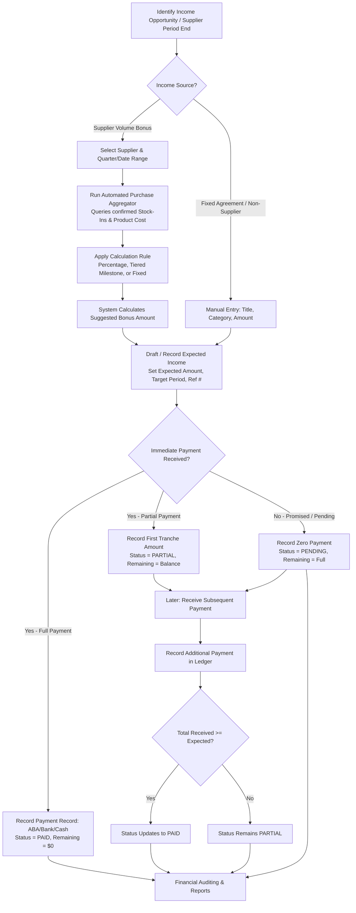
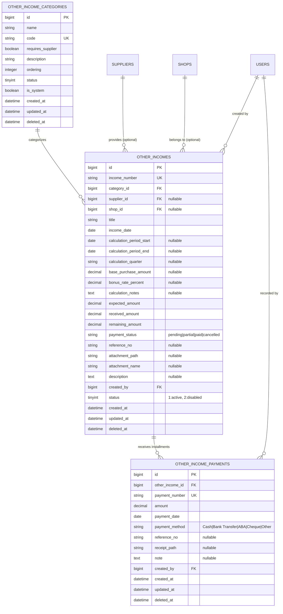

# Other Income & Supplier Bonus Management Module — Implementation Plan

**Document Version:** 1.0.0  
**Status:** Proposed for Architecture Review & Approval (No code or database changes have been executed)  
**Target System:** POS & Business Management System (Laravel 9 / PHP 8 / Blade / Alpine.js / MySQL / MDI Tab Workspace)  
**Creation Date:** 26 October 2026 (Asia/Phnom_Penh)  

---

## Executive Summary

The business frequently receives additional income from suppliers—primarily quarterly volume bonuses, purchase incentives, performance rebates, and cashback payments based on the aggregate value or volume of products purchased. In addition, the business requires the flexibility to track non-supplier miscellaneous income (such as asset/scrap disposal, rental/subletting space, promotional/marketing allowances, and insurance or damage compensations).

Currently, the system lacks a dedicated mechanism to record, calculate, track, and report on these non-sales income streams. Without this module:
1. Income from supplier bonuses is untracked in the POS/ERP ledger or recorded informally, obscuring true profitability.
2. The business cannot verify whether suppliers have paid agreed quarterly rebates or track partial/outstanding balances.
3. Purchasing managers cannot easily calculate bonus entitlements against actual historical stock-in purchase amounts.
4. Financial and management reports do not capture supplementary cash flows alongside sales and expenses.

This document presents a comprehensive, production-grade Implementation Plan for the **Other Income Management Module**, incorporating an automated **Supplier Bonus Calculation Engine**, **Payment Tracking (Expected vs. Received & Partial Payments)**, **Category Management**, **Bilingual Localization (English & Khmer)**, **MDI Workspace Integration**, and **Standardized Excel Reporting**.

---

## 1. Business Process Analysis & Workflow Architecture

### 1.1 Supplier Bonus & Additional Income Scenarios

```
+----------------------------------------------------------------------------------------------------+
|                                    OTHER INCOME STREAM TYPES                                       |
+----------------------------------------------------------------------------------------------------+
|                                                                                                    |
|  1. SUPPLIER-LINKED INCOME                                                                         |
|     +-- A. Quarterly / Periodic Purchase Volume Bonus (e.g., 2% on $50,000 Q3 purchases)           |
|     +-- B. Tiered Performance Rebates (e.g., $500 if >$20k, $1,500 if >$50k, $4,000 if >$100k)     |
|     +-- C. Product-Specific Purchase Cashback (e.g., $0.50/carton on newly stocked energy drinks)  |
|     +-- D. Marketing & Display Support (e.g., Supplier pays $300/mo for prime front shelf space)   |
|     +-- E. Damaged / Returned Goods Cash Settlement (Reimbursement directly paid into bank)        |
|                                                                                                    |
|  2. GENERAL / NON-SUPPLIER INCOME                                                                  |
|     +-- A. Recycling & Scrap Material Sales (Empty cardboard cartons, pallets, metal scrap)        |
|     +-- B. Space Rental / Subletting (ATM placement, coffee cart kiosk, vending machine rent)      |
|     +-- C. Delivery / Transport Service Surcharges (Non-invoiced direct logistic income)           |
|     +-- D. Bank Interest & Favorable Currency Exchange Realization                                 |
|     +-- E. Miscellaneous Extraordinary Receipts                                                    |
+----------------------------------------------------------------------------------------------------+
```

### 1.2 End-to-End Business Lifecycle



---

## 2. Current System Analysis & Technical Audit

### 2.1 Architecture & Stack Alignment

The project operates under:
- **Framework:** Laravel 9 with PHP 8.1+
- **Architecture Pattern:** Multi-Document Interface (MDI) Tab Workspace (`workspace-tab-bar.blade.php`), where pages load via AJAX inside dynamic workspace tab panels without refreshing the main window.
- **Frontend Core:** Blade templates, Alpine.js (reactivity & modals), jQuery 3.6+, jQuery UI (Datepicker), Select2 (custom dropdowns), Feather Icons & Boxicons (`bx-*`).
- **Database:** MySQL with InnoDB engine, Eloquent models with SoftDeletes.
- **Excel Export Engine:** Client-side workbook construction via `ExcelJS` and `FileSaver.js`, paired with server-side JSON stream endpoints (`report()`), complying strictly with `.agents/rules/report-standards.md`.

### 2.2 Existing Entities & Integration Touchpoints

| Entity / Model | Verified Current Schema & Attributes | Integration Approach for Other Income |
| :--- | :--- | :--- |
| `suppliers` (`Supplier`) | `id`, `name`, `ordering`, `image`, `user_id`, `status`, `deleted_at` | Direct FK `supplier_id` on `other_incomes`. Zero modifications to existing supplier records. |
| `stock_ins` (`StockIn`) | `id`, `product_id`, `shop_id`, `supplier_id`, `qty`, `status` (1=confirmed), `created_at` | Serves as the authoritative data source for the **Supplier Bonus Calculator**. Read-only query. |
| `products` (`Product`) | `id`, `code`, `name`, `cost` (decimal), `price`, `uom_id`, `status` | Supplies the cost basis for purchase valuation (`stock_ins.qty * products.cost`). Read-only query. |
| `shops` (`Shop`) | `id`, `name`, `phone`, `address`, `status` | Optional FK `shop_id` to attribute income to a specific store branch or global HQ. |
| `users` (`User`) | `id`, `name`, `email`, `role`, `status` | Audit FK `created_by` to track which staff member recorded each transaction and payment. |
| `staff_expenses` (`StaffExpense`) | `id`, `staff_id`, `shop_id`, `type`, `amount`, `expense_date`, `status` | Architectural twin: Other Income matches the clean service/controller/report design of Staff Expenses. |
| `order_payments` (`OrderPayment`) | `id`, `order_id`, `amount`, `payment_method`, `payment_date`, `note` | Model pattern for `other_income_payments` (itemized payment receipts). |

---

## 3. Proposed Database Structure & Migrations

To guarantee complete financial fidelity, support multi-tranche payments, and preserve full auditability of bonus calculations, the proposed solution comprises three relational tables:



### 3.1 Migration 1: `create_other_income_categories_table.php`

```php
Schema::create('other_income_categories', function (Blueprint $table) {
    $table->id();
    $table->string('name', 100);
    $table->string('code', 50)->unique();
    $table->boolean('requires_supplier')->default(false);
    $table->string('description', 255)->nullable();
    $table->integer('ordering')->default(0);
    $table->tinyInteger('status')->default(1)->comment('1: Active, 2: Disabled');
    $table->boolean('is_system')->default(false);
    $table->timestamps();
    $table->softDeletes();

    $table->index('status');
    $table->index('ordering');
});
```

**Default Seeded Categories:**
1. `supplier_bonus`: Supplier Volume Bonus / Rebate (ប្រាក់លើកទឹកចិត្តប្រចាំត្រីមាសពីអ្នកផ្គត់ផ្គង់) — `requires_supplier = true`
2. `supplier_cashback`: Supplier Cashback / Incentives (ប្រាក់ត្រឡប់ពីអ្នកផ្គត់ផ្គង់) — `requires_supplier = true`
3. `supplier_marketing`: Marketing & Shelf Space Support (ជំនួយទីផ្សារ និងការតាំងបង្ហាញ) — `requires_supplier = true`
4. `damaged_compensation`: Damaged / Return Goods Settlement (សំណងទំនិញខូចខាត) — `requires_supplier = true`
5. `scrap_sales`: Scrap / Packaging Material Sale (ការលក់សម្ភារអេតចាយ/កេស) — `requires_supplier = false`
6. `rental_sublet`: Space Rental / Subletting Income (ចំណូលពីការជួលទីតាំង) — `requires_supplier = false`
7. `financial_gain`: Interest & Forex Gain (ការប្រាក់ ឬចំណេញអត្រាប្តូរប្រាក់) — `requires_supplier = false`
8. `miscellaneous`: Other Miscellaneous Income (ចំណូលផ្សេងៗ) — `requires_supplier = false`

### 3.2 Migration 2: `create_other_incomes_table.php`

```php
Schema::create('other_incomes', function (Blueprint $table) {
    $table->id();
    $table->string('income_number', 50)->unique()->comment('e.g. INC-202610-0001');
    $table->unsignedBigInteger('category_id')->comment('FK to other_income_categories');
    $table->unsignedBigInteger('supplier_id')->nullable()->comment('FK to suppliers');
    $table->unsignedBigInteger('shop_id')->nullable()->comment('FK to shops');
    $table->string('title', 255)->comment('Brief summary or promotion name');
    $table->date('income_date')->comment('Accounting recognition date');
    
    // Calculation & Auditing metadata
    $table->date('calculation_period_start')->nullable();
    $table->date('calculation_period_end')->nullable();
    $table->string('calculation_quarter', 20)->nullable()->comment('e.g. 2026-Q3');
    $table->decimal('base_purchase_amount', 15, 2)->default(0.00);
    $table->decimal('bonus_rate_percent', 5, 2)->nullable();
    $table->text('calculation_notes')->nullable();

    // Financial balance tracking
    $table->decimal('expected_amount', 15, 2)->default(0.00);
    $table->decimal('received_amount', 15, 2)->default(0.00);
    $table->decimal('remaining_amount', 15, 2)->default(0.00);
    $table->string('payment_status', 20)->default('pending')->comment('pending, partial, paid, cancelled');

    // External Reference & Documentation
    $table->string('reference_no', 100)->nullable()->comment('Supplier letter/invoice ref');
    $table->string('attachment_path', 500)->nullable()->comment('Relative path to receipt/contract');
    $table->string('attachment_name', 255)->nullable()->comment('Original filename');
    $table->text('description')->nullable()->comment('Detailed remarks');

    $table->unsignedBigInteger('created_by')->comment('FK to users');
    $table->tinyInteger('status')->default(1)->comment('1: Active, 2: Disabled');
    $table->timestamps();
    $table->softDeletes();

    // Foreign Keys
    $table->foreign('category_id')->references('id')->on('other_income_categories')->onDelete('restrict');
    $table->foreign('supplier_id')->references('id')->on('suppliers')->onDelete('set null');
    $table->foreign('shop_id')->references('id')->on('shops')->onDelete('set null');
    $table->foreign('created_by')->references('id')->on('users')->onDelete('restrict');

    // Performance Composite Indexes
    $table->index(['income_date', 'status']);
    $table->index(['supplier_id', 'income_date']);
    $table->index(['category_id', 'income_date']);
    $table->index(['shop_id', 'income_date']);
    $table->index(['payment_status', 'income_date']);
});
```

### 3.3 Migration 3: `create_other_income_payments_table.php`

```php
Schema::create('other_income_payments', function (Blueprint $table) {
    $table->id();
    $table->unsignedBigInteger('other_income_id');
    $table->string('payment_number', 50)->unique()->comment('e.g. PAY-INC-202610-0001');
    $table->decimal('amount', 15, 2);
    $table->date('payment_date');
    $table->string('payment_method', 50)->default('Cash')->comment('Cash, Bank Transfer, ABA, Cheque, Other');
    $table->string('reference_no', 100)->nullable()->comment('Bank txn ID / slip #');
    $table->string('receipt_path', 500)->nullable()->comment('Bank slip attachment');
    $table->text('note')->nullable();
    $table->unsignedBigInteger('created_by');
    $table->timestamps();
    $table->softDeletes();

    $table->foreign('other_income_id')->references('id')->on('other_incomes')->onDelete('cascade');
    $table->foreign('created_by')->references('id')->on('users')->onDelete('restrict');

    $table->index(['other_income_id', 'payment_date']);
    $table->index('payment_date');
});
```

---

## 4. Supplier Bonus Calculation Engine

One of the primary requirements is calculating supplier bonuses based on actual purchase values, rates, or quarters.

### 4.1 Purchase Aggregation Logic

When a supplier and period are selected in the UI:
1. The backend inspects `stock_ins` where:
   - `supplier_id = :supplier_id`
   - `status = 1` (Confirmed Stock In)
   - `deleted_at IS NULL`
   - `created_at` (or transaction date) is between `calculation_period_start` and `calculation_period_end`
   - (Optionally filtered by `shop_id` if shop-specific bonuses apply)
2. Each stock-in item is joined with `products` on `stock_ins.product_id = products.id`.
3. Total purchase value is calculated as:
   $$\text{Total Purchase Amount} = \sum (\text{stock\_ins.qty} \times \text{COALESCE}(\text{products.cost}, 0))$$
4. Total quantity and transaction count are aggregated for auditing:
   $$\text{Total Units} = \sum (\text{stock\_ins.qty})$$
   $$\text{Total Deliveries} = \text{COUNT}(\text{DISTINCT stock\_ins.id})$$

### 4.2 Bonus Calculation Models

The module supports 4 standard calculation models:

| Model | Formula | Business Use Case |
| :--- | :--- | :--- |
| **A. Flat Percentage Rate** | $\text{Bonus} = \text{Purchases} \times (\frac{\text{Rate \%}}{100})$ | General supplier agreements (e.g., 2% quarterly rebate on total invoiced purchases). |
| **B. Tiered Milestone Target** | Tiers: <br>• $<\$20\text{k} \to 0\%$ <br>• $\$20\text{k} - \$49.9\text{k} \to 2\%$ <br>• $\$50\text{k} - \$99.9\text{k} \to 3.5\%$ <br>• $\ge \$100\text{k} \to 5\%$ | Annual/Quarterly incentive agreements where higher purchase volume unlocks higher rebate tiers. |
| **C. Fixed Target Lump-Sum** | If $\text{Purchases} \ge \text{Target}$, Bonus = Fixed $\$X$; else $\$0$ | Targeted promotions (e.g. hit $\$30,000$ this quarter to receive a flat $\$1,200$ bonus). |
| **D. Per-Unit Incentive** | $\text{Bonus} = \text{Total Inward Quantity} \times \text{Rate Per Unit}$ | Case/carton push incentives (e.g. $\$0.50$ per case of beverage purchased). |

### 4.3 Interactive Calculation Wizard in UI

In the income creation/edit screen, an interactive **"Calculate from Purchases" (គណនាពីការទិញ)** panel will be provided:
- **Quarter Selector:** Dropdown offering `Q1 (Jan-Mar)`, `Q2 (Apr-Jun)`, `Q3 (Jul-Sep)`, `Q4 (Oct-Dec)`, or `Custom Date Range`.
- **Live Sync Button:** Queries `admin/other-income/calculate-purchases` via AJAX.
- **Preview Metrics Card:** Shows Total Purchases ($), Total Units, Number of Deliveries, and Eligible Products.
- **1-Click Apply:** Automatically transfers the calculated amount into the `expected_amount` field and fills `calculation_notes` for audit traceability.

---

## 5. UI/UX Design & System Integration

### 5.1 Menu & Navigation Placement

In accordance with `config/menu.php`, the module will be positioned cleanly:
1. **Setting & Application Group:**
   - **Other Income (ចំណូលផ្សេងៗ):** Main CRUD listing, payment recording, and balance tracking (`admin/other-income/list/1`).
   - **Income Categories (ប្រភេទចំណូល):** Category configuration (`admin/other-income-category/list/1`).
2. **Report Management Group:**
   - **Other Income Report (របាយការណ៍ចំណូលផ្សេងៗ):** Financial reporting with Daily/Monthly views and Excel export (`admin/report/other-income/daily`).

### 5.2 Strict Compliance with Project Standards

#### A. Select2 Standard Rules (`AGENTS.md`)
- Container wrapper: `<div class="select2Group">`
- Select element: `class="SelectField select2"`
- Height: `43px`, border radius: `7px`, border: `#cbd5e1`, focus border: `#2563eb` with `box-shadow: 0 0 0 2px rgba(37,99,235,0.12)`
- Clear button: `.select2Reset` containing the standard `18x18px` SVG cross icon, hidden when empty, styled with hover `#ef4444`.
- Script: Bound with `window.$select2FocusInputSearch()` on `select2:open`.

#### B. DatePicker Standard Rules (`.agents/rules/datepicker-standards.md`)
- jQuery UI Datepicker initialization within Alpine `$nextTick()`.
- Inputs: `type="text"`, `autocomplete="off"`, `dateFormat: 'yy-mm-dd'`, `changeYear: true`, `changeMonth: true`, `yearRange: '-50:+10'`.
- Popup layering: Add `.other-income-datepicker` class on `beforeShow` with `z-index: 9999 !important` and remove on `onClose`.
- Linked ranges: From Date selection limits To Date's `minDate`; To Date selection limits From Date's `maxDate`.

#### C. Report & Excel Export Standard Rules (`.agents/rules/report-standards.md`)
- Two-stage export workflow: `excel()` initiates loading state and gathers parameters; `runExcelExport(reportData)` constructs the ExcelJS workbook.
- Overlay: Standard `<div class="loadingFullSizeLayout">` with `#spinner` during export.
- Parameter harvesting: `getExportParams()` extracts active MDI tab parameters, DOM form inputs, and Select2 values, while strictly removing `page` (`params.delete('page')`).
- Asset inclusion: `@include('admin::pages.report.partials.excel-assets')` and `@include('admin::pages.report.partials.excel-request')`.

### 5.3 UI Components Breakdown

```
+---------------------------------------------------------------------------------------------------------+
| [OTHER INCOME LISTING SCREEN]                                                                           |
|                                                                                                         |
| Top KPI Badges:                                                                                         |
| [ Total Income: $18,450.00 ]  [ Received: $14,200.00 ]  [ Outstanding: $4,250.00 ]  [ Active: 14 ]    |
|                                                                                                         |
| Filter Bar:                                                                                             |
| [ From Date: 2026-07-01 ] [ To Date: 2026-09-30 ] [ Supplier: Heineken Cambodia [x] ]                 |
| [ Category: Supplier Bonus [x] ] [ Status: All Payments [v] ] [ Search: Q3 Bonus... ] [Filter] [Reset] |
|                                                                                                         |
| Data Table:                                                                                             |
| +----+-------------+----------------------+--------------------+-----------+----------+-----------+-----+
| | Nº | Income #    | Title & Supplier     | Category           | Expected  | Received | Balance   | Stat|
| +----+-------------+----------------------+--------------------+-----------+----------+-----------+-----+
| | 1  | INC-2610-01 | Q3 Purchase Rebate   | Supplier Bonus     | $2,400.00 | $1,200.00| $1,200.00 | [P] |
| |    |             | Heineken Cambodia    |                    |           |          |           |     |
| | 2  | INC-2610-02 | Cartons Scrap Sale   | Scrap/Packaging    |   $150.00 |   $150.00|     $0.00 | [F] |
| +----+-------------+----------------------+--------------------+-----------+----------+-----------+-----+
| Actions: [View Details / Payment Ledger]  [Record Payment]  [Edit]  [Delete]                            |
+---------------------------------------------------------------------------------------------------------+
```

### 5.4 Payment Tracking Workflow (Full & Partial Payments)

The screen features a quick modal: **"Record Payment" (កត់ត្រាការទូទាត់ប្រាក់)**:
- Displays Income Title, Supplier, Expected Amount, and Remaining Balance.
- Amount Field: Pre-filled with Remaining Balance (editable for partial payment).
- Payment Method: Dropdown (`Cash`, `Bank Transfer (ABA)`, `Cheque`, `Other`).
- Payment Date: Datepicker (defaults to today).
- Reference / Slip #: Text input (e.g., ABA transaction ID `ABA89234823`).
- File Upload: Optional upload for payment slip / bank advice.
- When saved:
  - An `other_income_payments` record is created.
  - Parent `other_incomes.received_amount` is incremented.
  - Parent `remaining_amount` is recomputed: $\text{expected} - \text{received}$.
  - Status updates automatically: `paid` if remaining $\le 0$, else `partial`.

---

## 6. Financial Reporting & Excel Export

### 6.1 Report Views & Modes

1. **Daily View (`/admin/report/other-income/daily`):**
   - Filter by date range with quick presets: `Today`, `Yesterday`, `7 Days`, `30 Days`, `This Month`, `Last Month`.
   - **Grouped Mode:** Aggregates records by Day (`YYYY-MM-DD`), displaying daily transaction count, expected total, received total, and outstanding total. Clicking a day expands an itemized drill-down modal (`details/{period}`).
   - **Ungrouped Mode:** Lists every single income record matching the active filters with pagination (50/page).
2. **Monthly View (`/admin/report/other-income/monthly`):**
   - Filter by Year and Month Range (e.g., 2026, Months 1 to 12).
   - **Grouped Mode:** Aggregates records by Month (`YYYY-MM`), showing active transaction days, monthly gross income, collected cash, and remaining receivables.
   - **Ungrouped Mode:** Itemized chronological listing across the selected months.

### 6.2 Summary KPI Metrics

The report header displays 5 real-time summary cards:
1. **Total Expected Income:** $\sum \text{expected\_amount}$
2. **Total Collected Cash:** $\sum \text{received\_amount}$
3. **Total Outstanding Balance:** $\sum \text{remaining\_amount}$
4. **Supplier Rebate Proportion:** Percentage of total other income generated by supplier incentives vs. general income.
5. **Top Contributor:** Leading supplier or income source with highest cash contribution.

### 6.3 ExcelJS Export Workbook Architecture

Compliant with `.agents/rules/report-standards.md`, the client-side workbook will feature:
- Sheet Name: `Other Income Report` (or `ចំណូលផ្សេងៗ`)
- Header Styling: Primary dark blue/slate fill (`#1E293B` or `#E2E8F0`), bold white/dark font, centered alignment.
- Formatted Columns:
  1. `Nº` (Width: 8)
  2. `Income Reference` (Width: 18)
  3. `Income Date` (Width: 14)
  4. `Category` (Width: 20)
  5. `Supplier / Payer` (Width: 24)
  6. `Shop / Branch` (Width: 18)
  7. `Calculation Period / Quarter` (Width: 16)
  8. `Base Purchase Amount ($)` (Width: 18, `numFmt: '#,##0.00'`)
  9. `Rate / Rule` (Width: 12)
  10. `Expected Amount ($)` (Width: 18, `numFmt: '#,##0.00'`)
  11. `Received Amount ($)` (Width: 18, `numFmt: '#,##0.00'`)
  12. `Remaining Balance ($)` (Width: 18, `numFmt: '#,##0.00'`)
  13. `Payment Status` (Width: 14)
  14. `Remarks` (Width: 30)
- Grand Totals Row: Bold summary row computing formulas `=SUM(...)` for Base Purchases, Expected Amount, Received Amount, and Remaining Balance.

---

## 7. Role-Based Access Control & Permissions

Following `config/admin_permissions.php` and `database/seeders/PermissionSeeder.php`, the following granular permissions will be registered:

### 7.1 Module Permissions

| Permission Name | Display Name | Scope / Action |
| :--- | :--- | :--- |
| `other-income-view` | View | Access listing, history, and detail views |
| `other-income-create` | Create | Access creation form and calculate bonuses |
| `other-income-update` | Edit | Modify income records and record payments |
| `other-income-delete` | Delete | Move income records to trash |
| `other-income-restore` | Restore | Restore soft-deleted records |
| `other-income-force-delete` | Destroy | Permanently purge records from database |
| `other-income-excel` | Excel | Export records to CSV / Excel |
| `other-income-category-view` | View | View income category settings |
| `other-income-category-create`| Create | Add new income categories |
| `other-income-category-update`| Edit | Update existing categories |
| `other-income-category-delete`| Delete | Disable or remove custom categories |
| `report-other-income-view` | View | Access Other Income Report (daily/monthly) |
| `report-other-income-excel`| Excel | Export Other Income Report to Excel |

---

## 8. Step-by-Step Implementation Roadmap

```
+---------------------------------------------------------------------------------------------+
|                                IMPLEMENTATION PHASES                                        |
+---------------------------------------------------------------------------------------------+
| Phase 1: Database Architecture & Core Models                                                |
|   1. Create migrations for categories, other_incomes, and payments.                         |
|   2. Implement Eloquent models (OtherIncome, OtherIncomeCategory, OtherIncomePayment).       |
|   3. Define relationships, query scopes, casts, and auto-calculating accessors.             |
|                                                                                             |
| Phase 2: Service Layer & Bonus Calculation Engine                                           |
|   1. Create OtherIncomeService for CRUD transactions, payment posting, and balance sync.    |
|   2. Implement SupplierBonusCalculator to aggregate stock-in purchases and calculate bonus. |
|                                                                                             |
| Phase 3: Permissions, Routing & Navigation                                                  |
|   1. Update config/admin_permissions.php, config/menu.php, and create PermissionSeeder.    |
|   2. Register CRUD and calculation routes in routes/admin.php.                              |
|   3. Update App\Support\AdminPermissions.php.                                               |
|                                                                                             |
| Phase 4: Localization & Form Requests                                                       |
|   1. Create lang/en/other_income.php and lang/km/other_income.php.                          |
|   2. Create OtherIncomeRequest and OtherIncomePaymentRequest for strict validation.         |
|                                                                                             |
| Phase 5: Administration UI & Modals                                                         |
|   1. Build listing view (index.blade.php) using @component('admin::components.listingData').|
|   2. Build store view (store.blade.php) with Select2, Datepicker, and Bonus Calculator.     |
|   3. Build payment modal & ledger view for partial payment history.                         |
|                                                                                             |
| Phase 6: Reporting Engine & Excel Export                                                    |
|   1. Implement OtherIncomeReportController (daily, monthly, report, details).               |
|   2. Build Blade report views following Sales Report / Staff Expense Report pattern.        |
|   3. Implement ExcelJS export generator with filter harvesting (getExportParams).           |
|                                                                                             |
| Phase 7: Quality Assurance & End-to-End Testing                                             |
|   1. Verify unit/feature tests for calculations, payments, and permission checks.           |
|   2. Conduct MDI tab filter synchronization and browser interaction verification.           |
+---------------------------------------------------------------------------------------------+
```

---

## 9. Impact Analysis & Safeguards

| Component | Potential Risk | Mitigation / Safeguard |
| :--- | :--- | :--- |
| **Existing Order/Sales Module** | Regression or interference | Zero touch. Other Income operates completely independently in its own tables and routes. |
| **Stock & Inventory Module** | Accidental stock level mutation | The Supplier Bonus Calculator executes strictly read-only queries against `stock_ins` and `products`. It never modifies inventory balances. |
| **MDI Workspace Navigation** | Filter state loss during tab switches | Strict compliance with `getExportParams()` harvesting filters from active MDI tab instances and component DOM, avoiding reliance on browser URL. |
| **Database Performance** | Slow purchase aggregation on large datasets | Composite index on `stock_ins(['supplier_id', 'status', 'created_at'])` ensures purchase calculations execute in milliseconds. |
| **Data Integrity on Deletions** | Orphaned payment records | Cascade soft-deletes and foreign key protections ensure payments are archived consistently if an income record is removed. |

---

## 10. Verification & Test Scenarios

To ensure defect-free deployment, the following test scenarios will be executed:

1. **Category Management Test:**
   - Create custom category (e.g. "Bottle Recycling"). Verify active status and ordering.
   - Verify system categories (`supplier_bonus`, `supplier_cashback`) cannot be permanently destroyed.
2. **Supplier Bonus Calculation Test:**
   - Select Supplier with existing stock-ins in Q3 2026.
   - Trigger calculator: Verify total purchase amount matches $\sum (\text{qty} \times \text{cost})$.
   - Apply 3% rate: Verify calculated bonus equals $\text{Purchases} \times 0.03$.
3. **Single Full Payment Test:**
   - Record other income with immediate full payment via ABA Bank Transfer.
   - Verify `expected_amount = $500`, `received_amount = $500`, `remaining_amount = $0`, `payment_status = 'paid'`.
4. **Partial Payment & Ledger Test:**
   - Record expected bonus of $\$1,000$ (Status: Pending, Remaining: $\$1,000$).
   - Record 1st payment of $\$400$: Status becomes `partial`, Remaining becomes $\$600$.
   - Record 2nd payment of $\$600$: Status becomes `paid`, Remaining becomes $\$0$.
   - Inspect itemized payment history: Verify both tranches are recorded with respective bank references.
5. **MDI Filter & Excel Export Test:**
   - Filter listing by Supplier "Heineken" and Date Range.
   - Click "Export to Excel": Verify full-screen spinner `<div class="loadingFullSizeLayout">` appears.
   - Inspect downloaded `.xlsx`: Verify it contains only filtered records, correct mathematical sums, and no pagination truncation.
6. **Datepicker & Select2 Verification:**
   - Verify Select2 dropdown renders at 43px height, with clear reset button functioning.
   - Verify jQuery UI Datepicker appears above content (`z-index: 9999`) and From/To limits link properly.

---

## 11. Recommended Value-Add Enhancements

Beyond the core requirements, the following high-value enhancements are recommended for future scalability:

1. **Supplier Rebate Agreement Contracts:**
   - Store agreed rebate terms per supplier (e.g., "Supplier ABC contractually pays 2.5% quarterly if purchases exceed $30,000").
   - When a quarter ends, the system can display a proactive notification: *"Q3 has ended: You have $1,450 in unbilled bonuses from Supplier ABC ready to claim."*
2. **Comprehensive P&L (Profit & Loss) Statement Integration:**
   - Combine Sales Revenue (Orders) − Cost of Goods Sold (COGS) − Operating Expenses (Staff Expenses) + **Other Income (Supplier Bonuses)** to show true **Net Business Profit**.
3. **Credit Note (Offset against Supplier Invoices):**
   - Option to apply a received supplier bonus as a credit offset against a future stock-in delivery payment rather than collecting cash/bank transfer.
4. **Receipt Voucher Printable PDF:**
   - Provide a clean, branded PDF voucher for non-supplier income receipts (e.g., official receipt issued to scrap buyer or rental tenant).

---

## 12. Next Steps & Approval Request

This Implementation Plan is submitted for your review. No code or database alterations have been performed. 

Upon your approval of this plan, implementation will proceed systematically in accordance with the roadmap.
