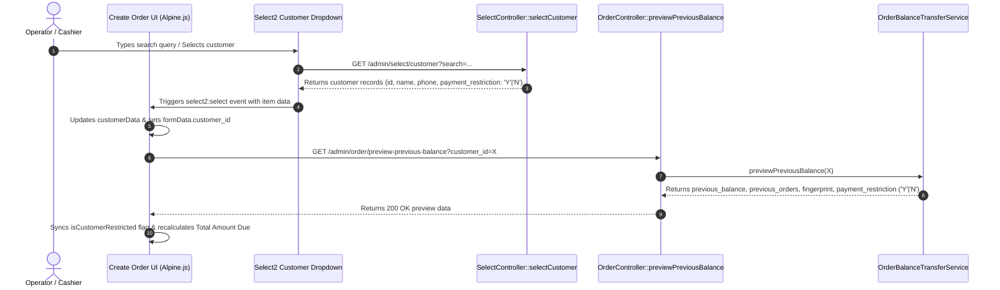

# Implementation Plan: Customer Full-Payment Restriction in Order Module

## 1. Executive Summary & Objectives

The goal of this feature is to introduce a **Customer Full-Payment Restriction** into the existing POS Order Module.

In business operations, certain customers must not be granted credit or allowed to leave balances in a `Pending` or `Partial` status (e.g., high-risk credit profiles, cash-only clients, or restricted accounts). When an order is created for a restricted customer:
1. The customer must pay **100% of the total Balance Due** (including current order items and any consolidated previous unpaid balances) before the order can be submitted.
2. **Partial** and **Pending** payment options are strictly prohibited for restricted customers.
3. If an unrestricted customer is selected, existing payment options (**Paid, Partial, and Pending**) remain fully supported.
4. When changing or switching customer selection dynamically, the payment requirements and UI validation must automatically update.
5. In Customer Management, the configuration is provided as a standard dropdown field: **Payment Restriction** with values:
   - **`N`**: **No** (Unrestricted, default)
   - **`Y`**: **Yes** (Full payment required)
6. All calculations, discounts, previous balance transfers, stock updates, and unaffected workflows must remain 100% intact.

---

## 2. Current Architecture & Flow Analysis

### 2.1 Customer Model & Configuration
- **Model:** `Customer` (`app/Models/Customer.php`)
- **Table:** `customers` with columns:
  `['id', 'name', 'ordering', 'phone', 'address', 'profile', 'password', 'total_point', 'user', 'status', 'created_at', 'updated_at', 'deleted_at']`
- **Customer Form:** `resources/admin/views/pages/customer/store.blade.php` allows editing `name`, `phone`, `status` (Active/Disable), `address`, and `profile`.
- **Finding:** Currently, there is no restriction flag or field on `customers`. To support this requirement cleanly, an additive column `payment_restriction` (`char(1)` / string, default: `'N'`) will be added to `customers`.

### 2.2 Customer Lookup & Selection Workflow


### 2.3 Payment Calculation & Current Validation
- **Total Amount Due Formula:**
  $$\text{Total Amount Due} = \max(0, \text{Current Order Total} + \text{Consolidated Previous Balance})$$
- **Frontend Validation:** Currently in `createOrder.blade.php` (`validateOrderBeforeSubmit()`):
  - Checks if `partial_payment_amount` is $\ge 0$ and $\le \text{Total Amount Due}$.
  - Any amount is allowed:
    - $\$0 \implies \text{Order created as Pending}$
    - $\$0 < \text{amount} < \text{Total Due} \implies \text{Order created as Partial}$
    - $\text{amount} = \text{Total Due} \implies \text{Order created as Paid}$
- **Backend Validation:** In `OrderController::Save()`:
  - Records payment via `recordInitialPayment()` and updates order status via `syncOrderPaymentState()`.
  - Does not currently enforce full payment for restricted customers.

---

## 3. Detailed Gap Analysis

| Feature Area | Current Implementation | Required Behavior |
| :--- | :--- | :--- |
| **Customer Configuration** | Only `name`, `phone`, `status`, `address`, `profile`. | Add `payment_restriction` column (`'N'` = No, `'Y'` = Yes, default `'N'`). |
| **Customer Store View** | Status row only has one field. | Form layout updated to `row-2`: Status on left, **Payment Restriction (`N: No` / `Y: Yes`)** dropdown on right. |
| **Customer Form Request** | Validates only status. | Add validation rule: `'payment_restriction' => 'required\|in:N,Y'`. |
| **Select2 Customer Results** | Returns customer model attributes without restriction metadata. | Expose `payment_restriction` in `selectCustomer()` response. |
| **Previous Balance Preview API** | Returns previous balances and orders without restriction metadata. | Include `payment_restriction` in preview response. |
| **Frontend Alpine.js State** | No tracking of customer restriction. | Track `isCustomerRestricted` reactively; auto-update when customer changes. |
| **Payment UI Form** | Always displays optional partial payment input. | When restricted (`payment_restriction === 'Y'`): show prominent notice stating full payment is required; auto-fill full balance due on selection. |
| **Client Validation** | Allows $0 payment (Pending) or partial amount. | For restricted customer: enforce payment amount == 100% of Total Amount Due. Reject $0 or partial payment with inline error. |
| **Server Validation** | Allows any non-negative payment up to total due. | In `OrderController::Save()`, verify that if customer is restricted (`payment_restriction === 'Y'`), payment cents == total due cents. Reject with 422 if not paid in full. |
| **Unrestricted Customers** | Can create Pending, Partial, or Paid orders. | Preserve existing behavior 100% without alterations. |

---

## 4. Technical Architecture & Implementation Steps

```mermaid
flowchart TD
    A["Operator selects Customer in Order Form"] --> B{"Customer payment_restriction == 'Y'?<br/>('Yes')"}
    
    B -->|Yes| C["UI enters Restricted Mode"]
    C --> D["Display 'Full Payment Required' notice"]
    D --> E["Auto-fill Total Amount Due in Payment Field"]
    E --> F{"Operator submits Order"}
    F --> G{"Payment == 100% of Total Due?"}
    G -->|No (0 or Partial)| H["Block Submit: Display Inline Error & Toast"]
    G -->|Yes (Full Payment)| I["Send POST to /admin/order/save"]
    I --> J{"Backend Verification:<br/>Payment == Total Due?"}
    J -->|No| K["Rollback & Return 422 Validation Error"]
    J -->|Yes| L["Commit Order as 'Paid'"]

    B -->|No ('N')| M["UI remains in Standard Mode"]
    M --> N["Allow Pending ($0), Partial, or Full Payment"]
    N --> O["Submit Order with standard payment handling"]
```

### 4.1 Step 1: Database Migration
Create migration `database/migrations/2026_10_28_000003_add_payment_restriction_to_customers_table.php`:
```php
<?php

use Illuminate\Database\Migrations\Migration;
use Illuminate\Database\Schema\Blueprint;
use Illuminate\Support\Facades\Schema;

return new class extends Migration
{
    public function up(): void
    {
        Schema::table('customers', function (Blueprint $table) {
            $table->string('payment_restriction', 1)
                ->default('N')
                ->comment('N = No (Unrestricted), Y = Yes (Full Payment Required)')
                ->after('status')
                ->index();
        });
    }

    public function down(): void
    {
        Schema::table('customers', function (Blueprint $table) {
            $table->dropIndex(['payment_restriction']);
            $table->dropColumn('payment_restriction');
        });
    }
};
```

### 4.2 Step 2: Customer Model & Form Updates (N: No / Y: Yes Dropdown)
1. **Model:** In `app/Models/Customer.php`:
   - Add `'payment_restriction'` to `$fillable`.
   - Add helper:
     ```php
     public function isFullPaymentRestricted(): bool
     {
         return strtoupper((string) ($this->payment_restriction ?? 'N')) === 'Y';
     }
     ```
2. **Customer Form Request:** In `app/Http/Requests/Admin/CustomerRequest.php`:
   - Add rule: `'payment_restriction' => 'required|in:N,Y'`.
   - Add custom messages:
     - `'payment_restriction.required' => __('customer.validation.payment_restriction_required')`
     - `'payment_restriction.in' => __('customer.validation.payment_restriction_invalid')`
3. **Customer Form Blade View:** In `resources/admin/views/pages/customer/store.blade.php`:
   - Render the field side-by-side with Status using `row-2`:
     ```blade
     {{-- Status & Payment Restriction --}}
     <div class="row-2">
         <div class="form-row">
             <label>@lang('global.form.status.label') <span>*</span></label>
             <select name="status" id="status">
                 @foreach (config('dummy.status') as $key => $item)
                     <option value="{{ $key }}" {!! (request('id') && $data?->status == $key) || old('status', 1) == $key ? 'selected' : '' !!}>
                         {{ $key == 1 ? __('global.form.status.active') : __('global.form.status.disable') }}
                     </option>
                 @endforeach
             </select>
             @error('status')
                 <label class="error">{{ $message }}</label>
             @enderror
         </div>
         <div class="form-row">
             <label>{{ __('customer.form.payment_restriction.label') }} <span>*</span></label>
             <select name="payment_restriction" id="payment_restriction">
                 <option value="N" {!! (request('id') && $data?->payment_restriction === 'N') || old('payment_restriction', 'N') === 'N' ? 'selected' : '' !!}>
                     {{ __('customer.form.payment_restriction.no') }}
                 </option>
                 <option value="Y" {!! (request('id') && $data?->payment_restriction === 'Y') || old('payment_restriction') === 'Y' ? 'selected' : '' !!}>
                     {{ __('customer.form.payment_restriction.yes') }}
                 </option>
             </select>
             @error('payment_restriction')
                 <label class="error">{{ $message }}</label>
             @enderror
         </div>
     </div>
     ```

### 4.3 Step 3: Lookup & Preview APIs Synchronization
1. **Customer Select2 Search:** In `app/Http/Controllers/Admin/SelectController.php`:
   - The query returns `payment_restriction` (`'Y'` or `'N'`) so the client-side Select2 dropdown receives it immediately upon selection.
2. **Preview Previous Balance Service:** In `app/Services/OrderBalanceTransferService.php`:
   - Fetch the customer and add `payment_restriction` to the preview payload:
     ```php
     $customer = Customer::find($customerId);
     $restriction = $customer ? (string) ($customer->payment_restriction ?? 'N') : 'N';
     return [
         'customer_id' => $customerId,
         'payment_restriction' => $restriction,
         'is_restricted' => strtoupper($restriction) === 'Y',
         'previous_balance' => $totalPreviousBalance,
         // ...
     ];
     ```

### 4.4 Step 4: Frontend Order Creation (`createOrder.blade.php`)
1. **Alpine Component State:**
   - Add `isCustomerRestricted: false` to `XDatacreateorder()` state.
2. **Dynamic Listener & Sync:**
   - In `fetchSelectCustomer()`:
     - On `select2:select`:
       ```javascript
       const item = event.params.data.item || {};
       this.customerData = item;
       this.isCustomerRestricted = String(item.payment_restriction || '').toUpperCase() === 'Y';
       if (this.isCustomerRestricted && this.totalAmountDue() > 0) {
           this.formData.partial_payment_amount = Math.round(Number(this.totalAmountDue() || 0) * 100) / 100;
       }
       ```
     - On `select2:clear`, `select2:unselect`, or clearing selection:
       ```javascript
       this.isCustomerRestricted = false;
       delete this.dataError?.partial_payment_amount;
       ```
   - In `fetchPreviousBalance(customerId)`:
     - When receiving response data, reconcile:
       ```javascript
       this.isCustomerRestricted = Boolean(res.data?.data?.is_restricted ?? (String(res.data?.data?.payment_restriction || '').toUpperCase() === 'Y'));
       ```
   - In `resetCustomer()`:
     - Reset `this.isCustomerRestricted = false`.
3. **UI Indicators & Messaging:**
   - Inside the Initial Payment box, render a banner when `isCustomerRestricted` is true:
     ```blade
     <template x-if="isCustomerRestricted">
         <div class="booking-restricted-customer-banner" style="display:flex; align-items:center; gap:8px; padding:8px 12px; background:#fef2f2; border:1px solid #fecaca; border-radius:6px; margin-bottom:12px; color:#991b1b; font-size:12px; font-weight:500;">
             <svg xmlns="http://www.w3.org/2000/svg" width="14" height="14" viewBox="0 0 24 24" fill="none" stroke="currentColor" stroke-width="2"><circle cx="12" cy="12" r="10"></circle><line x1="12" y1="8" x2="12" y2="12"></line><line x1="12" y1="16" x2="12.01" y2="16"></line></svg>
             <span>{{ __('order.notice.full_payment_restricted') }}</span>
         </div>
     </template>
     ```
4. **Validation Logic in `validateOrderBeforeSubmit()`:**
   - Check if customer has restriction (`isCustomerRestricted === true`) and total balance due $> 0$:
     ```javascript
     const partialPayment = Number(this.formData.partial_payment_amount || 0);
     const totalDue = Number(this.totalAmountDue() || 0);
     const paymentCents = Math.round(partialPayment * 100);
     const totalDueCents = Math.round(totalDue * 100);

     if (this.isCustomerRestricted && totalDueCents > 0) {
         if (paymentCents < totalDueCents) {
             const template = @json(__('order.validation.full_payment_required'));
             errors.partial_payment_amount = [
                 template.replace(':amount', this.formatCurrency(totalDue))
             ];
         }
     } else {
         // Existing standard check for unrestricted customers
         if (partialPayment < 0) {
             errors.partial_payment_amount = [@json(__('order.validation.partial_min'))];
         } else if (paymentCents > totalDueCents) {
             errors.partial_payment_amount = [@json(__('order.validation.partial_max'))];
         }
     }
     ```

### 4.5 Step 5: Backend Enforcement (`OrderController.php`)
In `OrderController::Save()`:
```php
// Enforce full-payment restriction for restricted customers
$customer = Customer::find((int) $req->customer_id);
if ($customer && $customer->isFullPaymentRestricted()) {
    $totalDueCents = $this->paymentCents((float) $totals['total_price'] + (float) $order->previous_balance);
    $paidAmountCents = $this->paymentCents($req->partial_payment_amount ?? 0, 'partial_payment_amount');

    if ($totalDueCents > 0 && $paidAmountCents < $totalDueCents) {
        $formattedDue = '$' . number_format($totalDueCents / 100, 2);
        throw ValidationException::withMessages([
            'partial_payment_amount' => [
                __('order.validation.full_payment_required', ['amount' => $formattedDue])
            ],
        ]);
    }
}
```

---

## 5. Localization Strings

### English (`lang/en`)
- **`lang/en/order.php`**:
  ```php
  'validation' => [
      'full_payment_required' => 'This customer has a full-payment restriction. Full payment of :amount is required before submitting.',
  ],
  'notice' => [
      'full_payment_restricted' => 'Customer Full-Payment Restriction: Pending and Partial payments are not allowed for this customer.',
  ],
  ```
- **`lang/en/customer.php`**:
  ```php
  'form' => [
      'payment_restriction' => [
          'label' => 'Payment Restriction',
          'yes'   => 'Yes',
          'no'    => 'No',
      ],
  ],
  'validation' => [
      'payment_restriction_required' => 'Please select payment restriction.',
      'payment_restriction_invalid'  => 'The selected payment restriction is invalid.',
  ],
  ```

### Khmer (`lang/km`)
- **`lang/km/order.php`**:
  ```php
  'validation' => [
      'full_payment_required' => 'អតិថិជននេះមានការកម្រិតត្រូវបង់ប្រាក់ពេញលេញ។ ទឹកប្រាក់សរុបចំនួន :amount ត្រូវតែទូទាត់ពេញមុនពេលបញ្ជូនការបញ្ជាទិញ។',
  ],
  'notice' => [
      'full_payment_restricted' => 'ការកម្រិតបង់ប្រាក់ពេញ៖ មិនអនុញ្ញាតឱ្យជំពាក់ (Pending) ឬបង់ខ្លះ (Partial) សម្រាប់អតិថិជននេះឡើយ។',
  ],
  ```
- **`lang/km/customer.php`**:
  ```php
  'form' => [
      'payment_restriction' => [
          'label' => 'ការកម្រិតការទូទាត់ប្រាក់',
          'yes'   => 'បាទ/ចាស (Yes)',
          'no'    => 'ទេ (No)',
      ],
  ],
  'validation' => [
      'payment_restriction_required' => 'សូមជ្រើសរើសការកម្រិតការទូទាត់ប្រាក់',
      'payment_restriction_invalid'  => 'ការកម្រិតការទូទាត់ប្រាក់ដែលបានជ្រើសមិនត្រឹមត្រូវ',
  ],
  ```

---

## 6. Edge Cases & Guardrails

1. **Zero-Dollar Orders ($0 Total Due):**
   - If an order has a total due of $0.00 (e.g., 100% discount promotion or complimentary items), the restriction requirement ($0.00) is satisfied and the order can be submitted as `Paid` without throwing a payment error.
2. **Previous Balance Consolidation Interaction:**
   - If Customer A owes $30 from previous orders and places a new order of $70, the Balance Due is $100.
   - For a restricted customer (`payment_restriction = 'Y'`), entering $70 (only covering the current items) is **rejected**. The payment must cover the full $100.
3. **Switching Customers in the UI:**
   - If the operator selects a restricted customer (`payment_restriction = 'Y'`), the full-payment notice appears and the amount is filled.
   - If the operator changes their mind and selects an unrestricted customer (`payment_restriction = 'N'`), the restriction is immediately cleared, allowing standard partial/pending payment again.
   - If the customer field is cleared, all customer-specific restrictions and balances reset to zero.
4. **Precision & Rounding:**
   - All comparisons use cent-based integer conversion (`round($amount * 100)`) on both frontend and backend to avoid floating-point inaccuracies.
5. **Editing Existing Orders:**
   - Existing orders adhere to established lock rules (only `Pending` orders can be edited; transferred orders are locked). The restriction applies to new order creation and pending order edits.

---

## 7. Verification & Testing Scenarios

A dedicated automated test file `tests/Feature/CustomerFullPaymentRestrictionTest.php` will be created covering:

| Test Case | Conditions | Expected Outcome |
| :--- | :--- | :--- |
| **TC-01** | Unrestricted customer (`payment_restriction = 'N'`), payment = $0 | Order succeeds with status `Pending`. |
| **TC-02** | Unrestricted customer (`payment_restriction = 'N'`), payment = partial ($20 of $50) | Order succeeds with status `Partial`. |
| **TC-03** | Unrestricted customer (`payment_restriction = 'N'`), payment = full ($50 of $50) | Order succeeds with status `Paid`. |
| **TC-04** | Restricted customer (`payment_restriction = 'Y'`), payment = $0 | Submission rejected with 422 error (`full_payment_required`). |
| **TC-05** | Restricted customer (`payment_restriction = 'Y'`), payment = partial ($20 of $50) | Submission rejected with 422 error (`full_payment_required`). |
| **TC-06** | Restricted customer (`payment_restriction = 'Y'`), payment = 100% ($50 of $50) | Order succeeds with status `Paid`. |
| **TC-07** | Restricted customer with previous balance ($20 prev + $30 new = $50 due), payment = $30 | Submission rejected with 422 error (did not cover previous balance). |
| **TC-08** | Restricted customer with previous balance, payment = $50 | Order succeeds with status `Paid`; previous balance consolidated. |
| **TC-09** | Restricted customer with $0 order total | Order succeeds without payment error. |
| **TC-10** | Customer store/edit accepts `payment_restriction` as `'N'` (No) and `'Y'` (Yes) | Validated and persisted accurately in DB. |

---

## 8. Summary of Affected Files

1. `database/migrations/2026_10_28_000003_add_payment_restriction_to_customers_table.php` (New)
2. `app/Models/Customer.php` (Update)
3. `app/Http/Requests/Admin/CustomerRequest.php` (Update)
4. `resources/admin/views/pages/customer/store.blade.php` (Update)
5. `app/Http/Controllers/Admin/SelectController.php` (Update)
6. `app/Services/OrderBalanceTransferService.php` (Update)
7. `app/Http/Controllers/Admin/OrderController.php` (Update)
8. `resources/admin/views/pages/order/createOrder.blade.php` (Update)
9. `lang/en/order.php` & `lang/km/order.php` (Update)
10. `lang/en/customer.php` & `lang/km/customer.php` (Update)
11. `tests/Feature/CustomerFullPaymentRestrictionTest.php` (New)
