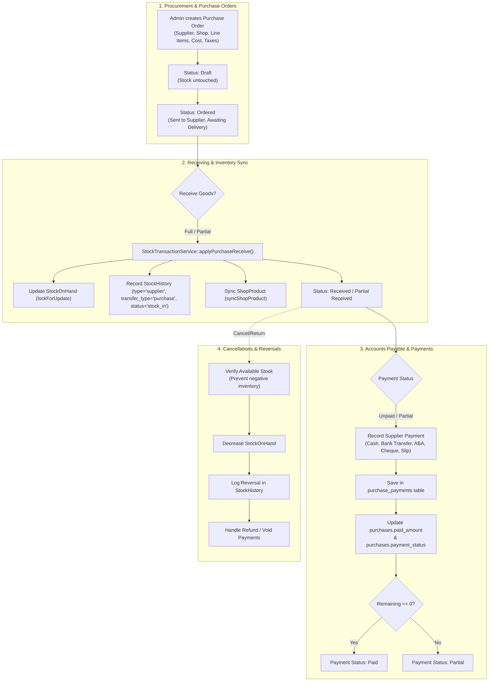

# Supplier Purchasing Module - Comprehensive Implementation Plan

- **Author**: Antigravity Assistant
- **Target System**: Laravel POS & Inventory Management System
- **Status**: Pending Review & Approval
- **File**: `docs/supplier-purchasing-implementation-plan.md`

---

## 1. Executive Summary & Architectural Vision

The **Supplier Purchasing** feature is designed to introduce an enterprise-grade procurement, inventory intake, and accounts payable (AP) subsystem into the POS platform.

Currently, inventory enters the system either through direct stock creation or via raw `StockIn` transaction records. While functional for basic stock adjustments, this does not support real-world commercial procurement where businesses must:
- Negotiate purchase orders (POs) with suppliers.
- Track supplier order statuses (`Draft`, `Ordered`, `Partial Received`, `Received`, `Cancelled`).
- Capture exact purchase costs per unit, freight/shipping charges, taxes, and supplier discounts.
- Manage Accounts Payable (AP) and supplier credit debt (tracking unpaid/partial balances, payment schedules, bank slips, and payment methods).
- Automatically synchronize received goods with `StockOnHand` and `StockHistory` with concurrency protection.
- Generate operational purchasing reports and export to Excel following project standards.

### Core Architectural Principles
1. **Zero Regression Strategy**: Existing modules (`StockInController`, `StockOutController`, `OrderController`, `SalesReportController`, `InventoryMovementReportController`) remain completely backward compatible and operational.
2. **Atomic Inventory Ledger**: When purchase orders are received or cancelled, stock adjustments are executed within database transactions with row-level locks (`lockForUpdate()`), preventing race conditions, phantom updates, and negative inventory.
3. **Strict Coding & UI Standards Compliance**:
   - **Select2 Standard**: Form fields follow the exact 43px height, `#cbd5e1` border, 7px radius, `.select2Group`, `.select2Reset` SVG, and `window.$select2FocusInputSearch()` standard.
   - **Datepicker Standard**: jQuery UI datepicker with `yy-mm-dd`, month/year selectors, `yearRange: '-50:+10'`, `gotoCurrent: true`, linked From/To ranges, and scoped `.sales-report-datepicker` popup class at `z-index: 9999`.
   - **Report & Excel Export Standard**: Reports follow the Order module's two-stage export workflow (`excel()` + `runExcelExport()`), full-screen `<div class="loadingFullSizeLayout">` spinner overlay, local assets, and MDI workspace filter harvesting via `getExportParams()`.

---

## 2. Business Workflows & Architecture



### Detailed Workflow States

| Status | Stock On Hand | Payment Status | Description |
| :--- | :--- | :--- | :--- |
| **Draft** | Not touched | Unpaid | Order is being prepared/planned. Editable. |
| **Ordered** | Not touched | Unpaid / Partial | Confirmed with vendor; awaiting shipment. |
| **Partial Received** | Incremented by received qty | Unpaid / Partial / Paid | Part of the order has been delivered and verified into warehouse. |
| **Received** | Incremented by total ordered qty | Unpaid / Partial / Paid | Complete goods received, inspected, and added to shop inventory. |
| **Cancelled** | Reversed (if previously received) | Voided / Refunded | Cancelled purchase. Stock reversed safely if already received. |

---

## 3. Database Schema & Architecture

### 3.1. Enhancement to Existing `suppliers` Table
We extend the `suppliers` table without removing or breaking existing columns (`id`, `name`, `ordering`, `image`, `user_id`, `status`):

```sql
ALTER TABLE `suppliers`
  ADD COLUMN `code` VARCHAR(50) NULL UNIQUE AFTER `id`,
  ADD COLUMN `contact_person` VARCHAR(100) NULL AFTER `name`,
  ADD COLUMN `phone` VARCHAR(50) NULL AFTER `contact_person`,
  ADD COLUMN `email` VARCHAR(100) NULL AFTER `phone`,
  ADD COLUMN `address` TEXT NULL AFTER `email`,
  ADD COLUMN `tax_number` VARCHAR(50) NULL AFTER `address`,
  ADD COLUMN `bank_name` VARCHAR(100) NULL AFTER `tax_number`,
  ADD COLUMN `bank_account_name` VARCHAR(100) NULL AFTER `bank_name`,
  ADD COLUMN `bank_account_number` VARCHAR(100) NULL AFTER `bank_account_name`,
  ADD COLUMN `notes` TEXT NULL AFTER `bank_account_number`;
```

### 3.2. New Table: `purchases`
Primary header table for purchases and vendor invoices:

```sql
CREATE TABLE `purchases` (
  `id` BIGINT UNSIGNED AUTO_INCREMENT PRIMARY KEY,
  `purchase_number` VARCHAR(50) NOT NULL UNIQUE COMMENT 'Auto-generated e.g. PUR-202611-0001',
  `supplier_invoice_no` VARCHAR(100) NULL COMMENT 'Vendor external invoice/bill number',
  `supplier_id` BIGINT UNSIGNED NOT NULL COMMENT 'FK to suppliers',
  `shop_id` BIGINT UNSIGNED NOT NULL COMMENT 'FK to shops (receiving branch/warehouse)',
  `purchase_date` DATE NOT NULL COMMENT 'Date of purchase order',
  `delivery_date` DATE NULL COMMENT 'Expected delivery/arrival date',
  `status` ENUM('draft', 'ordered', 'partial_received', 'received', 'cancelled') NOT NULL DEFAULT 'draft',
  `payment_status` ENUM('unpaid', 'partial', 'paid') NOT NULL DEFAULT 'unpaid',
  `payment_due_date` DATE NULL COMMENT 'Due date for invoice balance',
  
  -- Financial Calculations
  `subtotal` DECIMAL(15, 2) NOT NULL DEFAULT 0.00 COMMENT 'Sum of item costs before order adjustments',
  `discount_type` ENUM('fixed', 'percentage') NOT NULL DEFAULT 'fixed',
  `discount_rate` DECIMAL(10, 2) NOT NULL DEFAULT 0.00,
  `discount_amount` DECIMAL(15, 2) NOT NULL DEFAULT 0.00,
  `tax_rate` DECIMAL(5, 2) NOT NULL DEFAULT 0.00 COMMENT 'Tax percentage (e.g. 10.00 for 10% VAT)',
  `tax_amount` DECIMAL(15, 2) NOT NULL DEFAULT 0.00,
  `shipping_cost` DECIMAL(15, 2) NOT NULL DEFAULT 0.00 COMMENT 'Freight/delivery cost',
  `total_amount` DECIMAL(15, 2) NOT NULL DEFAULT 0.00 COMMENT 'Final invoice total: subtotal - discount + tax + shipping',
  `paid_amount` DECIMAL(15, 2) NOT NULL DEFAULT 0.00 COMMENT 'Total disbursed to date',
  
  -- Audit & Concurrency
  `creation_request_key` VARCHAR(100) NULL COMMENT 'Idempotency key',
  `remark` TEXT NULL,
  `created_by` BIGINT UNSIGNED NOT NULL COMMENT 'FK to users',
  `received_by` BIGINT UNSIGNED NULL COMMENT 'FK to users who verified stock receipt',
  `received_at` DATETIME NULL,
  `created_at` TIMESTAMP NULL,
  `updated_at` TIMESTAMP NULL,
  `deleted_at` TIMESTAMP NULL,
  
  -- Performance Indexes
  INDEX `idx_purchases_supplier_date` (`supplier_id`, `purchase_date`),
  INDEX `idx_purchases_shop_date` (`shop_id`, `purchase_date`),
  INDEX `idx_purchases_status` (`status`),
  INDEX `idx_purchases_payment_status` (`payment_status`),
  INDEX `idx_purchases_date` (`purchase_date`)
) ENGINE=InnoDB DEFAULT CHARSET=utf8mb4 COLLATE=utf8mb4_unicode_ci;
```

### 3.3. New Table: `purchase_items`
Detailed line items for each purchased product:

```sql
CREATE TABLE `purchase_items` (
  `id` BIGINT UNSIGNED AUTO_INCREMENT PRIMARY KEY,
  `purchase_id` BIGINT UNSIGNED NOT NULL,
  `product_id` BIGINT UNSIGNED NOT NULL,
  `uom_id` BIGINT UNSIGNED NULL COMMENT 'Snapshot of UOM at time of purchase',
  `ordered_qty` DECIMAL(10, 2) NOT NULL DEFAULT 1.00,
  `received_qty` DECIMAL(10, 2) NOT NULL DEFAULT 0.00,
  `unit_cost` DECIMAL(15, 2) NOT NULL DEFAULT 0.00 COMMENT 'Actual purchase price per unit',
  `discount_amount` DECIMAL(15, 2) NOT NULL DEFAULT 0.00 COMMENT 'Item-level discount',
  `tax_amount` DECIMAL(15, 2) NOT NULL DEFAULT 0.00 COMMENT 'Item-level tax',
  `subtotal` DECIMAL(15, 2) NOT NULL DEFAULT 0.00 COMMENT '(ordered_qty * unit_cost) - discount + tax',
  `update_product_cost` TINYINT(1) NOT NULL DEFAULT 1 COMMENT 'Flag to update products.cost',
  `remark` VARCHAR(255) NULL,
  `created_at` TIMESTAMP NULL,
  `updated_at` TIMESTAMP NULL,
  `deleted_at` TIMESTAMP NULL,
  
  INDEX `idx_purchase_items_purchase` (`purchase_id`),
  INDEX `idx_purchase_items_product` (`product_id`)
) ENGINE=InnoDB DEFAULT CHARSET=utf8mb4 COLLATE=utf8mb4_unicode_ci;
```

### 3.4. New Table: `purchase_payments`
Accounts Payable transactions recording disbursements to suppliers:

```sql
CREATE TABLE `purchase_payments` (
  `id` BIGINT UNSIGNED AUTO_INCREMENT PRIMARY KEY,
  `purchase_id` BIGINT UNSIGNED NOT NULL,
  `supplier_id` BIGINT UNSIGNED NOT NULL,
  `payment_number` VARCHAR(50) NOT NULL UNIQUE COMMENT 'e.g. PAY-PUR-202611-0001',
  `amount` DECIMAL(15, 2) NOT NULL,
  `payment_date` DATE NOT NULL,
  `payment_method` VARCHAR(50) NOT NULL DEFAULT 'Cash' COMMENT 'Cash, Bank Transfer, ABA, Cheque, Other',
  `reference_no` VARCHAR(100) NULL COMMENT 'Bank transaction ID / Cheque #',
  `receipt_path` VARCHAR(500) NULL COMMENT 'Attachment path for payment receipt slip',
  `receipt_name` VARCHAR(255) NULL COMMENT 'Original file name',
  `note` TEXT NULL,
  `created_by` BIGINT UNSIGNED NOT NULL COMMENT 'FK to users',
  `created_at` TIMESTAMP NULL,
  `updated_at` TIMESTAMP NULL,
  `deleted_at` TIMESTAMP NULL,
  
  INDEX `idx_purchase_payments_purchase` (`purchase_id`),
  INDEX `idx_purchase_payments_supplier` (`supplier_id`),
  INDEX `idx_purchase_payments_date` (`payment_date`)
) ENGINE=InnoDB DEFAULT CHARSET=utf8mb4 COLLATE=utf8mb4_unicode_ci;
```

---

## 4. Integration with Existing Modules & Service Layer

### 4.1. Concurrency-Safe PO & Payment Number Generation
Replicating `InvoiceService`'s atomic row-level locking pattern using `invoice_sequences` with prefix keys `PUR-` and `PAY-PUR-`:
- Generates monotonic, zero-padded reference numbers (`PUR-202611-0001`, `PAY-PUR-202611-0001`) without collision under concurrent submissions.
- Auto-initializes if the sequence is first used.

### 4.2. Inventory Synchronization (`StockTransactionService`)
We will extend `App\Services\StockTransactionService` with dedicated methods:

```php
public function applyPurchaseReceive(Purchase $purchase, array $receivedQuantities = []): void
{
    DB::transaction(function () use ($purchase, $receivedQuantities) {
        foreach ($purchase->items as $item) {
            $qty = isset($receivedQuantities[$item->id]) 
                ? (float) $receivedQuantities[$item->id] 
                : (float) $item->ordered_qty;

            if ($qty <= 0) continue;

            // 1. Atomically increase stock on hand
            $currentStock = $this->increaseStock(
                $purchase->shop_id, 
                $item->product_id, 
                $qty, 
                "Purchase #{$purchase->purchase_number}"
            );

            // 2. Sync shop product catalog binding
            $this->syncShopProduct($purchase->shop_id, $item->product_id);

            // 3. Log into stock_histories
            StockHistory::create([
                'transfer_id'     => $purchase->id,
                'stock_id'        => null,
                'product_id'      => $item->product_id,
                'current_stock'   => $currentStock,
                'stock_in'        => $qty,
                'stock_out'       => 0,
                'shop_id'         => $purchase->shop_id,
                'to_id'           => $purchase->supplier_id,
                'qty'             => $qty,
                'remark'          => "Purchase Invoice #{$purchase->purchase_number}",
                'status'          => 'stock_in',
                'type'            => 'supplier',
                'transfer_type'   => 'purchase',
                'request_by'      => Auth::id(),
                'request_by_type' => 'admin',
            ]);

            // 4. Update item received_qty
            $item->update(['received_qty' => (float)$item->received_qty + $qty]);

            // 5. Update master product cost if selected
            if ($item->update_product_cost && (float) $item->unit_cost > 0) {
                Product::where('id', $item->product_id)->update(['cost' => $item->unit_cost]);
            }
        }
    });
}
```

### 4.3. Reversal & Safe Cancellation
When canceling or editing a received purchase order:
1. Verify each line item's quantity against `StockOnHand::where('shop_id', ...)->where('product_id', ...)->lockForUpdate()`.
2. If `current_stock < return_qty`, throw a clean `ValidationException`: *"Cannot cancel purchase: Product [X] has already been partially sold or transferred."*
3. If stock is sufficient, decrease `current_stock` and record compensating `stock_out` reversal entries in `StockHistory` with `transfer_type = 'purchase_cancel'`.

---

## 5. User Interface & Project Standards Compliance

### 5.1. Listing Page (`admin/purchase/list/{status}`)
- **Status Filter Tabs**: `All`, `Draft`, `Ordered`, `Received`, `Cancelled`.
- **Payment Status Filter Pills**: `All`, `Unpaid`, `Partial`, `Paid`.
- **Date Range Filters**: Linked From/To jQuery UI Datepickers conforming to [datepicker-standards.md](file:///Users/longdy/Documents/Projects/Laravel/POSSystem/.agents/rules/datepicker-standards.md).
- **Search & Filter Bar**:
  - Select2 Supplier dropdown with `.select2Group` and `.select2Reset`.
  - Select2 Shop dropdown.
  - Search input for purchase number, supplier invoice number, and notes.
- **Action Buttons**: View, Edit (if draft/ordered), Receive Goods (if ordered), Make Payment, Print PO, Delete (soft-delete with trash restore support).

### 5.2. Create / Edit Form (`admin/purchase/create`, `admin/purchase/edit/{id}`)
- Built with Alpine.js (`x-data="xPurchaseForm"`) within the MDI workspace:
- **Card 1: Header Information**:
  - Supplier Select2 (with quick-select and clear button).
  - Shop Select2 (destination warehouse).
  - Purchase Date & Expected Delivery Date (`yy-mm-dd`).
  - Supplier Invoice Reference number (text field).
- **Card 2: Dynamic Items Grid**:
  - Live search / product selection dropdown with thumbnail, category, UOM, and current stock badge.
  - Ordered Quantity (decimal input).
  - Purchase Unit Cost (auto-prefilled with current `product.cost`, editable).
  - Line Total calculated automatically.
  - "Update Catalog Cost" checkbox per item.
  - Add Row button / Remove Row with shortcut.
- **Card 3: Summary & Order Adjustments**:
  - Subtotal (computed).
  - Order Discount (Fixed amount or %).
  - Order Tax / VAT (%).
  - Shipping / Freight Cost ($).
  - Grand Total ($).
  - Notes / Terms textarea.
- **Form Actions**:
  - Save as Draft (`status = 'draft'`).
  - Save & Confirm Order (`status = 'ordered'`).
  - Cancel / Back to listing.

### 5.3. Payment Modal / Slide-out (Accounts Payable)
- Accessible directly from the listing or purchase detail page.
- Displays summary: Total Amount, Already Paid, Outstanding Balance.
- Inputs:
  - Payment Amount (auto-fills remaining balance, validates against overpayment).
  - Payment Date (jQuery UI datepicker).
  - Payment Method (Select2: Cash, Bank Transfer, ABA, Wing, Cheque, Other).
  - Reference / Transaction No.
  - Bank slip / receipt file upload.
  - Payment note.
- History table listing past payments for this purchase with ability to download slips or void payments (subject to permission).

### 5.4. Purchase Print / Printable Voucher
- A clean, print-ready Purchase Order & Goods Receipt Note with company branding, supplier info, line items table, bank details, and signature blocks.

---

## 6. Permissions & Access Control

Integrated into `database/seeders/PermissionSeeder.php` under a new module group **"Supplier Purchasing"**:

| Permission Name | Display Name | Role Default | Description |
| :--- | :--- | :--- | :--- |
| `purchase-view` | View | Admin, Manager | View purchase list, filters, and purchase details |
| `purchase-create` | Create | Admin, Manager | Create new draft or ordered purchases |
| `purchase-update` | Edit | Admin, Manager | Modify draft/ordered purchases |
| `purchase-delete` | Delete | Admin | Soft delete purchases |
| `purchase-receive` | Receive Goods | Admin, Manager, Inventory | Verify incoming stock and sync inventory |
| `purchase-payment` | Payment / AP | Admin, Accountant | Record and view supplier payments |
| `purchase-excel` | Export Excel | Admin, Manager | Export filtered purchase lists to Excel |
| `purchase-print` | Print PO | Admin, Manager, Cashier | Print purchase orders and goods receipt notes |

Menu entry registered in `config/menu.php` under a dedicated group or alongside Inventory Management.

---

## 7. Reporting & Excel Export (Report Standards Compliance)

### 7.1. Purchases Report (`admin/report/purchase`)
Following [report-standards.md](file:///Users/longdy/Documents/Projects/Laravel/POSSystem/.agents/rules/report-standards.md):
- **Grouping Modes**: Daily, Monthly, Yearly, by Supplier, by Shop, and by Product.
- **KPI Summary Cards**:
  - Total Purchases Count.
  - Total Purchases Volume ($).
  - Total Paid Amount ($).
  - Total Outstanding Accounts Payable ($).
- **Two-Stage Excel Export**:
  - Triggered via `excel()`, setting `exportLoading = true` and activating `<div class="loadingFullSizeLayout">`.
  - Harvesting parameters via `getExportParams()`: parses active MDI workspace tab URL, FormData inputs, Select2 values, and date inputs.
  - Removes `page` parameter to export the full filtered dataset.
  - Uses `@include('admin::pages.report.partials.excel-assets')` (ExcelJS + FileSaver, no external CDNs).
  - Worker builder `runExcelExport(reportData)` formats columns, sets currency format (`$#,##0.00`), adds total summary rows, and downloads the file.

---

## 8. Validation Rules & Concurrency Safeguards

### 8.1. Purchase Form Request (`PurchaseRequest`)
- `supplier_id`: `required|exists:suppliers,id`
- `shop_id`: `required|exists:shops,id`
- `purchase_date`: `required|date_format:Y-m-d`
- `delivery_date`: `nullable|date_format:Y-m-d|after_or_equal:purchase_date`
- `items`: `required|array|min:1`
- `items.*.product_id`: `required|exists:products,id`
- `items.*.ordered_qty`: `required|numeric|min:0.01`
- `items.*.unit_cost`: `required|numeric|min:0`
- `discount_amount`: `nullable|numeric|min:0`
- `tax_rate`: `nullable|numeric|min:0|max:100`
- `shipping_cost`: `nullable|numeric|min:0`

### 8.2. Payment Form Request (`PurchasePaymentRequest`)
- `purchase_id`: `required|exists:purchases,id`
- `amount`: `required|numeric|min:0.01` (plus custom rule ensuring `amount <= purchase.remaining_amount`)
- `payment_date`: `required|date_format:Y-m-d`
- `payment_method`: `required|string|max:50`
- `receipt`: `nullable|file|mimes:jpeg,png,jpg,pdf|max:5120`

### 8.3. Concurrency Protection
- Double-click protection via UI submit locking and `creation_request_key` token verification.
- Inventory delta updates wrapped in `DB::transaction()` with `lockForUpdate()`.
- Sequence generation with 3-attempt automatic retry against deadlocks.

---

## 9. Potential Impacts & Mitigation Strategies

| Potential Risk | Impact Area | Mitigation Strategy |
| :--- | :--- | :--- |
| **Double Stock In** | Inventory / StockOnHand | Ensure manual `StockIn` remains distinct; receiving a purchase is logged with `transfer_type = 'purchase'`. Do not create redundant raw `StockIn` rows that would double-count inventory. |
| **Negative Inventory on Cancellation** | StockOnHand | Strict validation before reversing received purchases. Prevent cancellation if on-hand stock is lower than received quantity. |
| **MDI Tab Leaks & Select2 Clashes** | Front-end UI | Unique element IDs with instance prefixes (e.g. `id="purchase-supplier-select-{{ uniqid() }}"`), component-local Alpine references (`$refs`), and clean lifecycle teardown. |
| **Cost Inconsistency** | Product Catalog | Provide a granular checkbox `update_product_cost` per item so users can choose whether temporary price spikes update the master product cost. |

---

## 10. Phased Implementation Roadmap

### Phase 1: Database Migrations & Eloquent Models
- Migration for `suppliers` table additions.
- Migrations for `purchases`, `purchase_items`, and `purchase_payments` tables.
- Creation of `Purchase`, `PurchaseItem`, and `PurchasePayment` models with casts, relations, and computed attributes.

### Phase 2: Permissions, Seeders & Menu Registration
- Update `PermissionSeeder.php` with the 8 new purchase permissions.
- Run migration/seeder to populate `module_permissions` and `permissions`.
- Add menu entries in `config/menu.php` and localized labels in `lang/en` and `lang/km`.

### Phase 3: Service Layer & Business Logic
- Implement `PurchaseService`: calculation logic, atomic reference generator, status transitions.
- Implement `PurchasePaymentService`: payment processing, slip uploads, remaining balance recalculation.
- Extend `StockTransactionService` with `applyPurchaseReceive()` and reverse methods.

### Phase 4: Controllers & Validation
- Create `PurchaseController` (CRUD, status updates, receiving goods).
- Create `PurchasePaymentController` (Record payment, list payments, void payment).
- Create `PurchaseRequest` and `PurchasePaymentRequest`.

### Phase 5: Front-end Views & Alpine Components
- Develop `resources/admin/views/pages/purchase/index.blade.php` (Listing, tabs, filters).
- Develop `resources/admin/views/pages/purchase/create.blade.php` (Multi-item grid, live totals, Select2, jQuery UI Datepicker).
- Develop `resources/admin/views/pages/purchase/view.blade.php` (Detail view, print voucher, receiving workflow).
- Develop Payment modal partial.

### Phase 6: Reporting & Excel Export
- Create `PurchaseReportController` with daily/monthly/supplier groupings.
- Implement two-stage Excel export with full-screen spinner following [report-standards.md](file:///Users/longdy/Documents/Projects/Laravel/POSSystem/.agents/rules/report-standards.md).

### Phase 7: Verification & Testing
- Unit & feature tests for purchase creation, stock receiving, payment allocations, and cancellation locks.
- Manual verification across MDI workspace tabs and multi-currency formatting.
